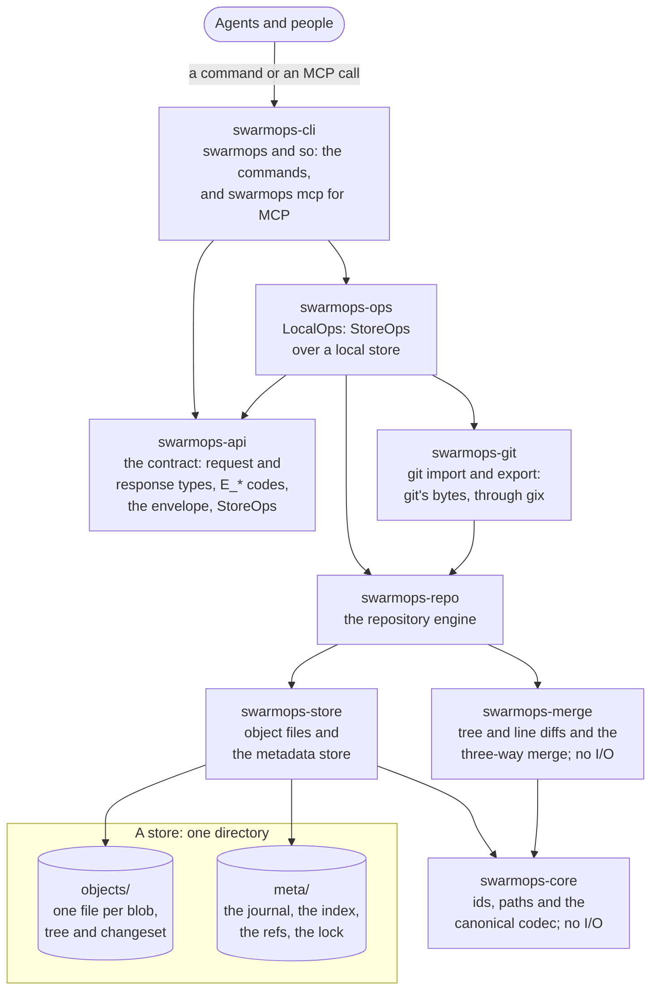

<p align="center">
  
</p>

<h1 align="center">SwarmOps</h1>

<p align="center">
  <strong>A git replacement for coding-agent swarms: many writers, one store, one JSON envelope per command.</strong>
</p>

<p align="center">
  <a href="https://github.com/KeiaiLab/SwarmOps/actions/workflows/ci.yml?query=branch%3Astable"></a>
  <a href="LICENSE"></a>
  <a href="docs/policies/msrv-and-platforms.md"></a>
  <a href="CHANGELOG.md"></a>
</p>

<p align="center">
  <a href="https://swarmops.cc">Website</a> ·
  <a href="#why-swarmops">Why</a> ·
  <a href="#swarmops-and-git">SwarmOps and git</a> ·
  <a href="#how-it-works">How it works</a> ·
  <a href="#quick-start">Quick start</a> ·
  <a href="#mcp">MCP</a> ·
  <a href="#commands">Commands</a> ·
  <a href="#roadmap">Roadmap</a> ·
  <a href="#documentation">Documentation</a>
</p>

SwarmOps is a git replacement for coding-agent swarms: many agents commit into one embedded store
at once, every command answers in JSON, and the work moves back to git. It is built for 10 to 50
Claude Code or LangGraph processes on one host, committing to one repository at once.
It is written in Rust and fully
embedded: one program, no external database, no daemon. It is pre-release, at milestone M8:
usable by one agent, with a store that already takes commits from many processes at once;
merging and landing, which a swarm needs, are built, but landing is not yet measured under a
swarm's load ([roadmap](#roadmap)).

## Why SwarmOps

A swarm of agents is not a team of people, and it needs other things from source control:

- **Many agents write at once.** Tens of agent processes commit into one repository on one host.
  SwarmOps gives them one store that each of them writes directly: object writes take no lock,
  metadata writes queue in the kernel for one lock, and refs move only by compare-and-swap.
- **Agents read answers, not prose.** Every command prints one JSON envelope: a stable `E_*`
  code, a fixed exit code, whether retrying can help, machine-readable `details` and a `hint`,
  often the next command to run. `swarmops schema` describes every type, and `swarmops mcp`
  serves the operations to MCP clients such as Claude Code.
- **Agents get killed mid-write.** Durability is full fsync, with no fast mode: a commit returns
  only once its journal frame is on disk, a crash leaves no stale lock, and the next writer
  repairs whatever a crash cut short. Crash sweeps, injected I/O errors and simulated power
  losses test this through the real binary.

## SwarmOps and git

SwarmOps is not meant as a general-purpose git replacement: it imports from git (M3) and exports
to it (M8). Where the two compare, this is where SwarmOps stands, judged strictly:

**Ahead**: built, with evidence · **Ahead by design**, **behind by design**: judged from the
design and the code, never measured against git · **Parity** · **Behind** · **Not yet
comparable**: not built yet. In the middle column, ✅ marks what is delivered and 📋 what is
planned, each with its milestone.

| Dimension | SwarmOps | Against git |
| --- | --- | --- |
| Hash | ✅ M0: BLAKE3-256 ids, with the object's kind and layout version hashed in. ✅ M1: every read re-hashes. | **Ahead** of git's default SHA-1: 128-bit collision resistance against at most 80 bits, by cryptanalysis, not by benchmark. **Parity** with git's opt-in SHA-256. |
| Order of writes | ✅ M1: every commit and ref move is a frame of one journal, appended under one lock, so all of them have a single global order. | **Ahead by design.** |
| Stale locks | ✅ M1: the writer lock is an `flock`, which the kernel releases when its holder dies. | **Ahead by design.** A git process killed with `SIGKILL` while it holds `index.lock` or a ref's `.lock` leaves the file behind, to be removed by hand (git removes its lock files on the signals it can catch). |
| Durability | ✅ M1: full fsync is the only mode; an object is synced before a journal frame names it, and a commit returns after its frame's `fdatasync`. ✅ M1.5: the policy for a failed fsync. | **Ahead by design.** Git's defaults (2.43) sync packs, pack metadata and the commit graph, not loose objects, refs or the index. |
| Machine-readable contract | ✅ M1: one JSON envelope per command, with a stable `E_*` code, a fixed exit code, `retryable`, `details` and a `hint`; a JSON Schema for every request and response. ✅ M1.6: an I/O failure names its operation and store file, and no host path but in two `E_IO`s (a symlink loop met while working out where the store's path leads, and tempfile's giving up after 65,536 taken temp-file names); a write reports what its recovery repaired (`meta.recovered`); `verify` lists typed findings. | **Ahead by design** for errors, which git reports as free text on stderr. Git's plumbing and `--porcelain` formats narrow the gap for output. Known gap: four codes are not raised yet. |
| Commits from many writers | ✅ M1: concurrent commits all succeed, short of a lock wait past 10 s or, since M1.6, a snapshot that meets a new commit in each of its 32 rounds (the retryable `E_BUSY`). | **Parity** with agents in separate git worktrees, on lost commits and lock failures. |
| One ref by compare-and-swap | ✅ M1: `ref set --expect` or `--create`, `ref delete --expect`; setting a ref to the target it holds is a replay. ✅ M1.6: `commit --advance` moves a ref to the new changeset in the commit's own transaction, or records nothing. | **Parity** with `git update-ref <ref> <new> <old>`, plus the replay. |
| Reading a path at a revision | ✅ M1: `cat REV:PATH` and `ls REV[:PATH]`, without a checkout. | **Parity** with `git show REV:PATH` and `git ls-tree`. |
| Offline, on one host | ✅ M1: no network code; every operation runs against the host's own store. | **Parity.** |
| Throughput of many writers | ✅ M1: writers take turns, each commit holding one store-wide lock across two journal `fdatasync`s, and two `fsync`s more when it moves a ref (`--advance`). | **Behind by design.** Agents in git worktrees serialize nothing, and git's defaults sync none of a commit's files. |
| Refs beyond one compare-and-swap | ✅ M1: refs are `main` and `release/<name>` only, moved one per call. | **Behind**: no multi-ref transactions, tags, free-form branch names or symbolic refs. |
| Breadth of reads | Today one file or one directory per call. ✅ M2: a file from a byte offset or by a range of lines, and a directory with the directories below it to a depth, each file with its size. 📋 M5: sparse workspaces. | **Behind**: git has batch reads, `git grep <tree>` and sparse checkouts. |
| Storage on disk | ✅ M1: one file per object, zstd-compressed when that makes it smaller; no packs, no delta compression. 📋 M6: gc, which removes leftovers but packs nothing. | **Behind by design**, in bytes and in files, against git's packs. |
| Conflicts | Since M3, `E_GIT_IMPORT_DIVERGED` signals a conflict when a git import's target and the git history have diverged. ✅ M4: `land` merges three-way without a checkout and reports a conflict as `E_CONFLICT` with a JSON report: each conflicting file's kind, its hunks (each side's lines, numbered as `cat --lines` takes them, and their text) and the target's changeset and agent that last changed it. ✅ M4: `land --resolve` resolves them without a checkout, path by path (take a side, new content, or delete), against the report's `theirs`; a path the target changed since comes back stale. | **Parity** with `git merge-tree --write-tree`, which merges without a checkout and reports typed conflicts. Resolving without a checkout is one request here, where git takes plumbing (`git hash-object`, a temporary index, `git commit-tree`). |
| Review | Nothing today. 📋 M7: change requests, their classification, approvals and a landing gate. | **Behind** today: git ships patch-review tools, and Gerrit and GitHub add review on top. M7 is **not yet comparable**. |
| Sync between hosts | ✅ M8: through a git remote, one writing host at a time: the writer exports, then pushes with git, and the others fetch with git, then import; two hosts that both write stop on `E_GIT_EXPORT_DIVERGED` or `E_GIT_IMPORT_DIVERGED` rather than merge. 📋 M11: offline-first sync, a full store on every host, `fetch` and `push` against one upstream. | **Behind**: git clones, fetches and pushes over any transport, and bundles without one. |
| Ecosystem | ✅ M1: the CLI and `swarmops schema`. ✅ M1.5: an MCP server. ✅ M3: git import. ✅ M8: git export. No user hooks, signing, submodules or LFS. | **Behind**, after v1 too: git parity is not a v1 goal, and git has MCP servers as well. |
| Maturity | Pre-release: v0.1.0 is the first tag, and the first spec dates from 2026-10-15. | **Behind**: git has hosted itself since 2005. |
| Landing | ✅ M4: `land` merges an agent's change onto `main` and publishes it as one changeset in one transaction, merging again and retrying by itself when `main` moves, and a retry with the same key replays it. 📋 M4, after the pilot: the landing model chosen by measurement. | **Ahead by design** of git alone, whose push refuses a moved branch and leaves the fetch, the merge and the retry to the pusher; not yet measured under a swarm's load. |

No git baseline has been measured: these verdicts come from the design, the code, and git's own
documentation and source, not from a benchmark, and a side-by-side benchmark against git
worktrees is not on the roadmap (umbrella spec §17). SwarmOps' own measurements are in
[docs/perf.md](docs/perf.md).

SwarmOps' design has prior art in git, Mononoke's Bonsai changesets and pushrebase, and jj's
operation log. It adapts several principles that Anthropic described for its in-house system
Scion, in the engineering post
["Redesigning source control at Anthropic"](https://www.anthropic.com/engineering/redesigning-source-control),
to a single host. SwarmOps is an independent project, not affiliated with or endorsed by
Anthropic, and contains no Scion code, which is not public.

<p align="center">
  <picture>
    <source media="(prefers-color-scheme: dark)" srcset="docs/assets/store-dark.svg">
    
  </picture>
  <br>
  <sub>The store as a machine: writers wait for one lock, which the kernel hands to one of them at
  a time, in no strict order, and each commit becomes one CRC-framed frame of the journal, while
  objects need no lock.
  <a href="https://swarmops.cc/explainers/store">Interactive version</a>
  (<a href="https://swarmops.cc/explainers/store-light">light</a>), drawn with
  <a href="https://github.com/wheresryan22/anatomy">Anatomy</a> (MIT,
  <a href="site/THIRD-PARTY-NOTICES.txt">notice</a>).</sub>
</p>

## How it works

Every operation is a library function: `swarmops-repo` does the work, `swarmops-ops` exposes it
as the `StoreOps` operations, and beside them `git import` and `git export`, which run through
`swarmops-git`; the binary parses a command line, calls one operation and prints its envelope.
An arrow between two crates points from a crate to one it depends on; the diagram leaves out the
shortcuts (`swarmops-ops` also uses `swarmops-core` and `swarmops-store` directly, `swarmops-git`
uses `swarmops-core` and `swarmops-store`, and `swarmops-repo` uses `swarmops-core`).
[docs/architecture.md](docs/architecture.md) lists every dependency and draws the write and read
paths.



### The store on disk

A store is one directory. `FORMAT` names its layout version (`init` writes it last, so a store
without it was never finished), and `REPO` the repository's id and name. `objects/` holds one
self-verifying, content-addressed file per blob, tree and changeset, in 256 fan-out directories
(`objects/<2 hex>/<62 hex>`), staged through `objects/tmp/`. `meta/` holds the metadata: an
append-only, CRC-framed journal (`journal.log`, with each frame's offset in `journal.off` and
how far it is materialized in `journal.ckpt`) that is its source of truth, the changeset index
built from it (`idx/`, `parents.log`, `sorted/`), one file per ref (`refs/`), the lock that
serializes writers (`lock`), the values derived from the history, a cache that is never synced
(`derived/`), and from M3 the git commit ids of imported and exported changesets (`external_ids/`).
Every object is durable before any metadata names it, and a write commits when its journal frame
is durable, so the next write repairs whatever a crash cut short.

## Quick start

### Install

```sh
curl -fsSL https://get.swarmops.cc/install.sh | bash
```

That installs `swarmops` and `so` from the latest [release](https://github.com/KeiaiLab/SwarmOps/releases),
checked against its `SHA256SUMS`, into `~/.local/bin` (`/usr/local/bin` as root). Run it again to
update. Options go after `bash -s --`:

```sh
curl -fsSL https://get.swarmops.cc/install.sh | bash -s -- --version 0.1.0     # pin a release
curl -fsSL https://get.swarmops.cc/install.sh | bash -s -- --dir /opt/swarmops/bin
curl -fsSL https://get.swarmops.cc/install.sh | bash -s -- --uninstall         # stores stay
```

Linux, x86_64 or aarch64, glibc 2.34 or newer (Ubuntu 22.04, Debian 12, RHEL 9). On glibc 2.34
to 2.38 every start prints one `ld.so` line on stderr, `weak version 'GLIBC_2.39' not found`;
exit codes, stdout and the MCP protocol are unaffected. The aarch64 build is cross-compiled and
smoke-tested under QEMU, not on aarch64 hardware. The installer needs no sudo for its default
directory, sends no telemetry and edits no shell startup file; `bash install.sh --help` lists every
option. To check a release by hand instead, each one holds a
`swarmops-<version>-<target>.tar.gz` per target and `SHA256SUMS`
([RELEASE.md](RELEASE.md) says how they are built).

From source, with Rust 1.99 (`rust-toolchain.toml` pins it):

```sh
cargo install --git https://github.com/KeiaiLab/SwarmOps --tag v0.1.0 --locked swarmops-cli
```

`so` is the short form of `swarmops`: the same program by a shorter name. An archive holds both,
and `cargo install` installs every binary of the crate: both names (add `--bin swarmops` for the
long name alone, if the name `so` is taken).

A store must live on a local filesystem that the store supports (ext4 with a journal, XFS or btrfs):
a path under `/mnt/` (where WSL mounts Windows drives) is refused with `E_UNSUPPORTED_FS`, and NFS,
SMB and FUSE mounts, Docker Desktop's and virtiofs bind mounts among them, are neither detected nor
supported.

### First commands

The examples use `so`, the short form; every command runs the same by either name. The hints in
the envelopes give their commands as `swarmops …`; only a usage error's hint, the usage line,
names the program as you invoked it (`Usage: so …`).

```sh
export SWARMOPS_REPO=~/.local/state/swarmops/repos/acme   # or --repo <store> on each command
export SWARMOPS_AGENT=agent/worker-1                       # or --as <family>/<instance>

so init "$SWARMOPS_REPO" --name acme
printf '#!/bin/sh\necho hello\n' > run.sh                 # the client file the second change reads
cat > changes.json <<'EOF'
[{"path": "src/lib.rs", "op": "put", "content": {"inline": "pub fn f() {}\n"}},
 {"path": "run.sh", "op": "put", "content": {"file": "./run.sh"}, "mode": "exec"}]
EOF
so commit -m "first" --changes changes.json --advance main  # creates main at the new changeset
so cat main:src/lib.rs
so ls main:src
so show main
so log -n 20
so op log -n 5                                            # the store's operations, newest first
so verify --deep
```

`--advance main` publishes the commit: the same transaction moves `main` to the new changeset,
only if `main` still names `--parent` (for a root commit, as here, only if `main` does not exist
yet), and otherwise the commit records nothing and fails with `E_CAS_MISMATCH`. A later publish
is a commit, then a land: `so commit -m … --changes … --parent <the id main held when you read
it>` records your change without moving any ref, and `so land <that changeset> --key <a new uuid
v7>` merges it three-way onto `main`'s head, whatever `main` gained since, and moves `main` to
the result in one transaction, as one new changeset whose parent is that head. A land that loses
a race to another publish merges again and retries by itself; a change that conflicts with what
`main` gained fails with `E_CONFLICT` (exit 3) and the conflict report in `details.report`,
recording nothing; and the same land run again with its key replays it (`status: replayed`).
`commit --parent <that id> --advance main` publishes in one step while `main` has not moved. To
move a ref past several changesets at once, commit them with `--parent`, then move it once with
`so ref set main <last> --expect <old>` (or `--create`).

`so op log` lists the store's operations, newest first: every commit, publish and ref move is
one write transaction, numbered in commit order (`op`). `so op undo <op>` moves every ref that
operation moved back to what it named before, all of them or none, by compare-and-swap: if
another operation has moved one of them since, it refuses with `E_CAS_MISMATCH` and writes
nothing. Changesets are never removed, and an undo is an operation of its own, which another
undo takes back.

Every command, its revisions and change lists, and its output are in [Commands](#commands).

## MCP

`swarmops mcp` serves the store to an agent as an MCP server on stdin and stdout, so that an agent
harness that speaks the Model Context Protocol, such as Claude Code, calls the operations as tools:
`repo_info`, `resolve_rev`, `read_file`, `read_tree`, `show`, `log`, `path_history`, `diff`,
`op_log`, `ref_list`, `ref_set`, `ref_delete`, `undo`, `commit`, `land`, `blob_put`, `blob_has` and
`verify`. A tool's arguments are the operation's request: its `inputSchema` is the request type's
schema, as `swarmops schema <Type>` prints it, with the definitions it refers to written in place,
and kept a plain object: a rule across fields that the type's schema states with a top-level
`oneOf`, which the Claude API refuses in a tool, is left to the description and to the server's own
check, and the `expected_old` of `ref_set` and `ref_delete` asks for a full changeset id. Its result
is the envelope the CLI prints for that request, as `structuredContent` and as text, and a failed
operation sets `isError`, with the envelope's `error` saying why. The server speaks MCP 2026-07-28,
and 2025-11-25 and 2025-06-18 to clients that open with `initialize`. Until M5's workspaces, an
agent cannot build or test a change on disk before it lands it;
[docs/operations.md](docs/operations.md) gives the stopgap.

### Register the server

Register it with Claude Code:

```sh
claude mcp add swarmops -- so mcp --repo <store> --as <agent>
```

or give a project a `.mcp.json`:

```json
{
  "mcpServers": {
    "swarmops": {
      "command": "swarmops",
      "args": ["mcp", "--repo", "/home/me/.local/state/swarmops/repos/acme"],
      "env": {"SWARMOPS_AGENT": "${SWARMOPS_AGENT:-}"}
    }
  }
}
```

A project's `.mcp.json` is shared by every agent that opens the project, so it takes each
agent's identity from that agent's own `SWARMOPS_AGENT`, which Claude Code expands into the
server's environment, rather than giving all of them one `--as`. For the same reason it runs
`swarmops`, not `so`: on some machine the short name may be missing (`--bin swarmops` installs
the long one alone) or belong to another program. The empty default (`:-`) is deliberate:
Claude Code passes an unset `${SWARMOPS_AGENT}` on as that very text, which the server refuses
as an invalid agent name (`E_INVALID_ARG`; `claude mcp list` warns too), but an empty value is
no identity, so a mutation by an agent without one gets `E_IDENTITY_REQUIRED`, as the next
section says.

Claude Code starts one server for a session, and the session's subagents share it, so every
commit and ref move they make is recorded for the session's agent. An agent that needs an
identity of its own runs as its own Claude Code process, with its own `SWARMOPS_AGENT`.

### Store, identity and lifetime

The store and the identity are the server's, as they are a command's: `--repo`, else
`SWARMOPS_REPO`, and `--as`, else `SWARMOPS_AGENT`, with `SWARMOPS_RUN_ID`. No call can name
another identity: every commit and ref move is recorded for the server's agent, and without one
they fail with `E_IDENTITY_REQUIRED`. The client starts the server as its own user, so the
server reads `{"file": "<path>"}` content as the CLI does, on its own machine; it refuses a
relative path (`E_INVALID_ARG`), since an agent cannot see the server's working directory; a
path that is the server's own stdin or stdout, the protocol's pipes; and anything that is not
a regular file (a FIFO, a socket, a device or a directory), which a read could block on: give
absolute paths, the store's too. It opens the store for each call, and so sees what other
agents commit meanwhile. The store runs in the server's process, so the server ends
with it on any of the store's four documented aborts (storage spec §2): a failed journal write
or sync whose cut-back fails too, in a write or in the repair before one, or frames that repair
writes afresh which land anywhere but where they were and cannot be cut back, which any commit
or ref move can meet; or an `init` that cannot take its `FORMAT` back, which no tool runs. The
client sees the server exit, and has to start it again.

### Rules for agents

Two rules matter more to an agent than to a person at the CLI:

- `ref_set` and `ref_delete` take `expected_old` as the full changeset id the ref held when the
  agent read it (from `ref_list`, `show`, `log` or a commit's result). A ref name or a relative
  revision such as `main~1` is read from the store when the call runs instead of pinning what
  the agent saw, so the compare-and-swap protects nothing (the ref's own name always matches,
  and `main~1` on `main` never does), and an id prefix stops resolving (`E_AMBIGUOUS_ID`) once
  another changeset shares it: the server refuses all three with `E_INVALID_ARG`. The CLI's
  `--expect` still takes any revision, and its help says why not to. A `commit` with `advance`
  takes its `parent` by the same rule, since the move expects the ref to name it.
- Clients limit long tool results. Claude Code saves a successful one over 25,000 tokens by
  default, or over 50,000 characters whatever its token count, to a file and gives the agent its
  path instead; it cuts only the text of an error. Each result holds its envelope twice, so an
  agent should ask for little: `max_bytes` of 32 KiB or less for `read_file`, a `limit` of 100
  or less for `read_tree` and `log`, paging on with the `cursor` a result returns, and
  `max_changes` of 100 or less for `show`. The tools' descriptions say so; the operations' own
  defaults stay as they are. `read_file` alone raises Claude Code's limit for itself: its entry
  in `tools/list` carries `_meta: {"anthropic/maxResultSizeChars": 200000}`, so Claude Code
  keeps a `read_file` result of up to 200,000 characters in the conversation instead of saving
  it to a file.

### When the server does not start

A command line that parses as `swarmops mcp` but is refused starts no server, and its envelope
goes to stderr, not to stdout, which belongs to the protocol. A usage error before the word
`mcp` (`swarmops --frob mcp`) is an ordinary command error, printed on stdout with exit code 2,
and starts no server either.

## Commands

| Command | What it does |
| --- | --- |
| `init <dir> [--name N]` | Create a store in `<dir>` (made if missing) and describe it. The name `N` (by default the directory's name) takes at most 255 bytes. |
| `info` | Describe the store: its id, name, `main`, and how many changesets and refs it holds. |
| `whoami` | The identity this caller's changes carry. |
| `commit -m MSG --changes FILE\|- [--parent REV] [--advance REF] [--key UUID] [--allow-empty]` | Record a changeset from a JSON change list, on `--parent` or else on `main`'s head (REF's, with `--advance`). With `--advance REF`, also move REF to it in the same transaction, if REF still names `--parent`; otherwise it records nothing. With `--key`, a uuid v7, the same commit run again replays the first run (`replayed: true`) instead of recording a second changeset. |
| `land HEAD [--base REV] [--target REF] [-m MSG] [--key KEY] [--max-attempts N] [--max-conflict-bytes N] [--resolve FILE]` | Merge HEAD's change (its first-parent chain after `--base`, by default the merge base of HEAD and REF's head) three-way onto REF (`main` by default) and publish it there as one new changeset in one transaction, merging again and retrying, up to N attempts, when REF moves meanwhile. A conflict is `E_CONFLICT` (exit 3) with the report in `details.report`, and nothing is recorded; land again with `--resolve` (a JSON file, or `-` for stdin: per path, take a side, new content or delete, against the report's `theirs`) to resolve it without a checkout. With `--key`, the same land run again replays (`status: replayed`). |
| `blob put FILE\|-`, `blob has ID…` | Store a file's content (stdin's for `-`) as a blob, outside any commit, and print its id; or list which of the ids the store holds blobs under. A change names a stored blob by id. |
| `resolve REV` | The full id of the changeset REV names, and its kind: `ref` when REV is exactly a ref's name, `changeset` otherwise. |
| `cat REV:PATH [--offset N \| --lines A-B] [--max-bytes N]` | One file at a revision, or part of it, from byte N or lines A to B: UTF-8 text, or base64. A read cut short gives `next_offset`, where `--offset` reads on. |
| `ls REV[:PATH] [--depth N] [--limit N] [--cursor C]` | One directory at a revision, a page at a time, each file with its size; with `--depth`, the directories below it too, each entry with its path. |
| `show REV [--max-changes N]` | One changeset: parents, author, message, changes, signatures. |
| `log [REV] [-n N] [--cursor C] [--path P]...` | History along first parents, newest first (from `main` by default); with `--path`, only the changesets that change those paths. |
| `diff FROM TO [--path P]... [--format names\|stat\|unified] [--context N] [--limit N] [--cursor C] [--max-bytes N]` | The files that differ between two revisions, in path order, a page at a time: each one's path and status (`added`, `deleted`, `modified`, `type_changed`); with `stat` also whether it is binary and its inserted and deleted lines; with `unified` also its kinds, blobs and hunks, the page within `--max-bytes` (32 KiB) of JSON. `--path` keeps the files at or below some paths. |
| `history REV:PATH [-n N] [--cursor C]` | The changesets that changed a file, or anything below a directory, newest first, each with what the path holds after it. |
| `ref list`, `ref set NAME REV (--expect OLD \| --create)`, `ref delete NAME --expect OLD` | List refs, or move one by compare-and-swap. |
| `op log [--before OP] [-n N] [--max-changesets N]` | The store's operations, newest first, a page at a time: each write transaction with its kind, its changesets and its ref moves. |
| `op undo OP` | Move every ref operation `OP` moved back to what it named before, by compare-and-swap in one transaction: all of them or none. |
| `verify [--deep]` | Check the store; `--deep` re-hashes every object and checks the derived values against the objects. |
| `derive [--after N] [--follow] [--interval-ms N] [--from-start]` | Derive ahead of any reader the eager derived values (the first-parent skip list) of the changesets the journal records. Once: up to 1,000 journal frames, from the first or after `--after N`, its `next` saying where to go on. With `--follow`: as they are committed, from the journal's end (its start with `--from-start`), until killed, one envelope a line for each run that derived something. |
| `schema [TYPE]` | The JSON Schema of every request and response type, or of one. |
| `git import PATH [--ref GIT_REF] [--into REF] [--lossy CLASS]... [--gitlinks refuse\|drop]` | Bring the history of the git repository at `PATH` in: every commit `--ref` (`HEAD`) reaches that the store does not hold, then move `--into` (`main`) to it ([Bring a git repository in](#bring-a-git-repository-in)). |
| `git export PATH [--ref REF] [--branch BRANCH] [--force]` | Write the history of `--ref` (`main`) into the git repository at `PATH`: every commit the last export into `--branch` (`main`) does not reach, then move `--branch` to the export of `--ref`'s head ([Send the work back to git](#send-the-work-back-to-git)). |
| `mcp` | Serve the operations to an agent as an MCP server on stdin and stdout ([MCP](#mcp)). |

### Revisions and change lists

A revision is `main`, `release/<name>`, a changeset id or a unique prefix of 12 or more of its
hex digits, then any number of `~N` (the N-th first parent). A change list is a JSON array of
`{"path", "op": "put" | "delete", "content", "mode"}`: a put's `content` is `{"inline": "<UTF-8
text>"}`, `{"base64": "<bytes>"}` or `{"file": "<path>"}` (read by the CLI, on the client), at
most 512 MiB, or `{"blob": "<id>"}`, a blob stored before (`blob put`), whose bytes the commit
neither sends nor reads; its `mode` is `file` (the default), `exec` or `symlink`; directories
follow from the paths. A commit's contents hold at most 1 GiB together (a blob named by id counts
nothing) and a change list's text at most 64 MiB (`E_TOO_LARGE` past either), so a large file
goes as `file` content, or through `blob put`. A ref moves only by compare-and-swap: when another agent moved it first,
`ref set` and `commit --advance` fail with `E_CAS_MISMATCH` (exit 4) and the ref's target in
`details.actual` (a `commit --advance` that fails so records nothing). Then land your change:
commit it on the head you read, and `land` merges it three-way onto the ref's head however far
the ref moved. Re-sending your old whole-file puts on top of `<actual>` would revert the
winner's edits to shared files; to publish without a land, read the files you changed at
`<actual>`, re-apply your edits to them, and publish with `commit --parent <actual> --advance
<ref>`, or commit with `--parent <actual>` and retry `ref set` with `--expect <actual>`.

### The store and the identity

`--repo <store>` names the store, else `SWARMOPS_REPO`. Reads need no identity. A commit, a ref
move or a git import needs one: `--as <family>/<instance>`, else `SWARMOPS_AGENT`, and `SWARMOPS_RUN_ID`
naming the agent's run if it has one. The changeset records it (and the journal records who
moved each ref); without one, a mutation fails with `E_IDENTITY_REQUIRED` (exit 5). A git export
needs none: it records nothing in the store's history, and writes only a git repository and the
store's caches.

### Bring a git repository in

`git import PATH` brings the history of the git repository at `PATH` into the store: a work tree
or a bare repository, read on this host (a relative path from the working directory), never by a
server. Every commit `--ref` reaches (`HEAD` by default) that the store does not hold becomes a
changeset, parents first, a merge with all of its parents in their order, and `--into` (`main`
by default) moves to the changeset of `--ref`'s commit, created if it does not exist.

```sh
so git import ~/src/acme --ref stable     # creates main, or moves it on from an earlier import
so git import ~/src/acme --ref stable     # again: imports 0, skips 1, writes nothing
```

An imported changeset is its git commit: its author and committer are the commit's, with their
exact times and offsets, in `show`'s `signatures`, and its `git.oid` metadata holds the commit's
id, which the changeset renders back to when nothing was lost. It records no agent, so `show` and
`log` attribute it to `unknown/unknown`, and the same git commit is the same changeset in every
store.

Run again, `git import` takes only the commits after the one the target's head holds, and writes
nothing when that is `--ref`'s commit. A target whose head is not the import of an ancestor of
`--ref`'s commit, because the git history was rewritten, or a changeset was committed on the
target that `git export` did not write, fails with `E_GIT_IMPORT_DIVERGED` (exit 3), and nothing
is written. A head that `git export` wrote is continued: commits made in git on top of that export
import linearly. An import cut short
says how many commits it recorded (`details.imported`), and the same command run again continues
after them.

Content a changeset cannot hold as git has it is refused with `E_GIT_IMPORT_LOSSY`, naming the
commit, the path and the class: a submodule's entry (`gitlinks`), a name that is not UTF-8 or is
`.` or `..` (`paths`), a mode git does not write (`modes`), a tree out of git's order
(`tree_order`), an empty directory (`empty_trees`), or a commit whose bytes its fields cannot give
back (`nonstandard`). `--lossy CLASS` (repeatable, or `all`) drops or normalizes that class
instead, and the changeset names it in its `git.lossy` metadata; `--gitlinks drop` is
`--lossy gitlinks`, and `--gitlinks`, given, decides that class whatever `--lossy` says. A
SHA-256 repository, reftable refs and a shallow clone are refused (`E_GIT_UNSUPPORTED`), and so
is an object the repository lacks, as a partial clone lacks blobs (`E_GIT_READ`). `git import`
is not an MCP tool: an agent runs it as a command.

### Send the work back to git

`git export PATH` writes the history behind a store ref (`--ref`, `main` by default) into a
branch (`--branch`, `main` by default) of the git repository at `PATH`, written on this host
(a relative path from the working directory), never by a server: a bare repository, which
`git init --bare` makes, or a work tree, whose checked-out branch it refuses as `git push` does
(`E_INVALID_ARG`). Every commit the branch does not reach is written, parents first: a changeset
imported from git as the commit it came from, byte for byte, and one made in the store as a
commit with its own author and committer and a `SwarmOps-Changeset:` trailer (with
`SwarmOps-Land-Key:` and `SwarmOps-Squashed-From:` once a land records them). The objects are made
durable before the branch moves, by compare-and-swap, and the same store gives the same commits
every time. It needs no identity.

```sh
so git export ~/src/acme --branch stable   # stable moves to the export of main's head
so git export ~/src/acme --branch stable   # again: exports 0, stable is up to date
git -C ~/src/acme push origin stable       # and on, as before
```

Run again, `git export` writes only what the branch's last export does not reach. A branch at a
commit that is no export of `--ref`'s head or of an ancestor of it fails with
`E_GIT_EXPORT_DIVERGED` (exit 3), and nothing is written; `details.reason` says why, and the hint
what to do: `branch_ahead` (commits made in git on top of the export, which `git import` brings
in), `both_moved` (git and the store both moved on, and nothing is merged), `branch_moved`,
`source_moved_back` (`--ref` moved back, as `swarmops op log` shows), `lossy_history` (the branch
holds the commits a lossy import was made of) or `moved_during_export` (run it again).
`--force` moves the branch all the same, still by compare-and-swap, replacing what git holds there.
A branch whose lock file another git process holds, or a dead one left, is refused
(`E_GIT_WRITE`, `ref_locked`) until the file is removed. `git export` is not an MCP tool: an agent
runs it as a command.

### Output and exit codes

Every command prints exactly one JSON envelope on stdout, but `derive --follow`, which prints one
envelope a line for each run that derived something (only `--help`, `--version` and the `help`
subcommand print plain text, and `mcp` speaks MCP there instead): pretty on a terminal,
compact otherwise (`--pretty[=BOOL]` decides), or a short text rendering with `--human` or
`SWARMOPS_FORMAT=human`. A run that meets one of the store's four documented aborts (storage
spec §2) prints no envelope: the process aborts, saying why on stderr.

```json
{"ok":true,"op":"read_file","api":1,"result":{"blob":"f5f5…","size":14,"kind":"file","encoding":"utf8","content":"pub fn f() {}\n","truncated":false},"meta":{"repo":"/home/me/.local/state/swarmops/repos/acme","elapsed_ms":0,"resolved":{"main":"014c…"},"auth":"trust"}}
{"ok":false,"op":"commit","api":1,"error":{"code":"E_IDENTITY_REQUIRED","message":"this operation changes the store, so it needs the caller's identity","retryable":false,"exit":5,"details":{},"hint":"pass --as <family>/<instance> or set SWARMOPS_AGENT, e.g. --as agent/worker-1"},"meta":{"repo":"…","elapsed_ms":0,"resolved":{},"auth":"trust"}}
```

`op` names the operation (`cat` is `read_file`), and `meta.resolved` what each revision named.
After a `commit`, `ref set` or `ref delete` whose write first repaired what an earlier writer
left behind, `meta.recovered` says what it repaired, on success and on `E_CAS_MISMATCH` alike;
it is no warning. A failure's `error` carries a stable `E_*` code, whether running it again can
succeed (as it is, or after re-reading what the error names), machine-readable `details` (for
an I/O failure, `fs_op` and `store_file`: the file operation that failed and its file in the
store, never a host path), and a `hint`, often the next command to run. The exit code is
`error.exit`:

| Exit | Meaning | For example |
| --- | --- | --- |
| 0 | Success. | |
| 1 | The operation failed. | `E_EMPTY_COMMIT`, `E_STORE_CORRUPT`, `E_IO` |
| 2 | A malformed request or command line. | `E_INVALID_ARG` |
| 3 | A conflict with what the change lands on: resolve it, then run it again. `land` could not merge the change onto the target, and recorded nothing; `details.report` says where. | `E_CONFLICT`, `E_GIT_IMPORT_DIVERGED`, `E_GIT_EXPORT_DIVERGED` |
| 4 | Retryable: the operation can succeed if run again (after a CAS mismatch, by a land, or on top of `details.actual` with your edits re-applied there). | `E_CAS_MISMATCH`, `E_CAS_RETRY_EXHAUSTED`, `E_BUSY`, `E_IO_TRANSIENT` |
| 5 | An identity or policy requirement refused it. | `E_IDENTITY_REQUIRED` |
| 6 | Something it names does not exist. | `E_NOT_A_REPO`, `E_REV_NOT_FOUND`, `E_PATH_NOT_FOUND` |

`swarmops schema` gives every type and error code; `ErrorCode` in
[crates/swarmops-api/src/error.rs](crates/swarmops-api/src/error.rs) is the one table of each
code's exit and `retryable` flag.

## Roadmap

The milestones of the umbrella spec (§13), in the order they are built. ✅ delivered · 📋 planned.

| Status | Milestone | Scope |
| --- | --- | --- |
| ✅ | M0 | Bootstrap: the workspace and its gates, the canonical codec and its golden vectors, the fsync experiment. |
| ✅ | M1 | The single-agent core: `init`, `commit`, `cat`, `ls`, `log` and ref compare-and-swap, over the native metadata store and object files; crash sweeps. |
| ✅ | M1.5 | Hardening and opening: CI behind one `tests-pass` check, `--locked` everywhere; I/O-error injection, write-ordering checks and the fsync-failure policy; power-loss images; the project policies; the tests' shared support in one crate; benchmarks of the metadata store against embedded databases; the MCP server and `so`. |
| ✅ | M1.6 | The code-review follow-ups, before M2: the error contract an agent sees (typed refusals, I/O failures that name the store file and no host path but in two rare `E_IO`s, a report of what a write's recovery repaired); a bound on the lock-free reader's retries; structured `verify` findings, and MCP tool schemas kept plain objects; object reads without a second copy or an allocation of the size a file claims; the test doubles M1.5 left, in one place; spec hygiene (the write-ordering rules W1–W7, §8 in step with the code); the harness for the measurements M2's sync decision needs, whose quiet-window runs are still to come; and `commit --advance`, the commit primitive M4's landing reuses. |
| ✅ | M2 | Diff, history and the derived-data engine. |
| ✅ | M3 | git import. |
| ✅ | M4 | Merge and landing, and the journal shown as an operation log with undo. Landing is a compare-and-swap loop that merges again, incrementally, when the target moves; its measurement under a swarm's load, and the landing model that measurement chooses, come next. |
| ✅ | M8 | git export, moved ahead so that work landed in SwarmOps goes back to git and today's deployment pipelines keep running. |
| 📋 | M12 | Portability: macOS and Windows builds, tests and releases. |
| 📋 | M5 | Workspaces, with an adapter for Claude Code's worktree hooks, so that an agent builds and tests a change on disk before it lands it. |
| 📋 | M6 | Verify, crash safety and fuzzing: fsck and repair, gc, detection of unsupported filesystems, bounded reads of store files, a capped `verify` report, and the next store `FORMAT`. |
| 📋 | M7 | Blame and review. |
| 📋 | M9 | Simulation and a benchmark gate: the store's own code under a deterministic simulator and in real processes killed at random, and benchmarks that fail on a regression. |
| 📋 | M11 | Remote sync, offline-first: a full store on every host, `fetch`, `push` and `sync status` against one upstream, over ssh. |

M0, M1, M1.5, M1.6, M2, M3, M4 and M8 make the first release, 0.1.0, together with the security
fixes in its [changelog](CHANGELOG.md), an [operations guide](docs/operations.md) and a
[pilot runbook](docs/pilot.md). The pilot runs SwarmOps' own repository through the round trip:
its history imported from git, changes committed and landed by agents through `swarmops mcp`,
and the result exported back to git for its CI to run. Next come the measurements that need a
quiet host: landing by 32 and 50 processes through the binary against umbrella §15's targets,
and the landing model those numbers choose; whether a transaction can sync the journal once
instead of twice; the import's and the export's timings on larger repositories. The order of
the milestones from M5 on is settled once the pilot has run; until then the table is the plan.

When it is usable (umbrella spec §1): by one agent from M1; by a swarm, landing through MCP,
from M4; on an existing git repository, its history imported and its landed work exported back
so that its CI and deployments run as before, from M8, in the first release; by agents that
build and test their changes in a workspace before they land them, from M5; with review from
M7; as the complete v1 at M9; across hosts, offline-first, from M11.
[docs/known-limitations.md](docs/known-limitations.md) lists what is still open, and which
milestone takes each item.

## Development

```sh
just check        # the definition of done: fmt, clippy -D warnings, tests, docs, cargo-deny
just check-slow   # more proptest cases, and the ignored tests: crash sweeps, contention, ...
just perf         # the M1 measurements, optimized; docs/perf.md records them
just fuzz [target]  # cargo-fuzz on nightly: codec_roundtrip, tree_decode, frame_decode, journal_recovery
just bench
just bench-compare  # the native metadata store against embedded databases (bench/compare/)
```

`scripts/check.sh` runs `just check`'s steps on a machine without `just`. Tests never need the
network; those that read real repositories on this host run only with `SWARMOPS_HOST_REPOS=1`.

### The `test-hooks` feature

The crash and fault tests drive five test-only environment variables:
`SWARMOPS_TEST_CRASH_AT=<k>` aborts the process at its k-th store filesystem call,
`SWARMOPS_TEST_FS_CALLS=<file>` makes it write how many calls it made,
`SWARMOPS_TEST_FAIL_AT=<k>[:once|persistent[:eio|enospc]]` fails its k-th call with an injected
I/O error (and with `persistent` every mutating call after it), `SWARMOPS_TEST_ORDER_CHECK=1`
checks every write against the store's write-ordering rules and panics at one that breaks a rule,
and `SWARMOPS_TEST_NOW=<unix seconds>` fixes the time it signs changesets at.
They act only in a build with the cargo feature `test-hooks` (on `swarmops-store`,
`swarmops-repo`, `swarmops-git`, `swarmops-ops`, `swarmops-cli` and `swarmops-testkit`, the tests'
support; `swarmops-cli/test-hooks` turns on all of them but `swarmops-git`'s). The gates build the
tests with `--all-features`; a
plain `cargo test` skips the tests that
need the hooks. Every other build, `cargo build --release` included, ignores the variables, and
`just check` runs a release build to show it.

## Documentation

The design documents are the authority: the umbrella spec and the storage, operations and review
specs, in Korean. The maintainers keep them privately, and
[docs/architecture.md](docs/architecture.md) is the public overview, in English.

| Document | What it holds |
| --- | --- |
| [docs/architecture.md](docs/architecture.md) | The design in English: crates, data model, the store on disk, the write and read paths, durability, concurrency, the contract. |
| [docs/operations.md](docs/operations.md) | Running SwarmOps: install, a store, agents through MCP, the daily loop between the store and git, checks, backup and restore, upgrades, limits and what to monitor. |
| [docs/pilot.md](docs/pilot.md) | The runbook of the first real use, on this repository: import, one agent session, export, CI, what to measure, the success criteria and the rollback. |
| [docs/known-limitations.md](docs/known-limitations.md) | What is still open, and which milestone takes each item. |
| [docs/perf.md](docs/perf.md) | Every measurement, and the decisions taken on them. |
| [bench/compare/README.md](bench/compare/README.md) | The harness that measures the native metadata store against embedded databases. |
| [docs/policies/versioning-and-stability.md](docs/policies/versioning-and-stability.md) | What stays compatible, and how a breaking change is made. |
| [docs/policies/msrv-and-platforms.md](docs/policies/msrv-and-platforms.md) | The Rust version and the platforms SwarmOps supports. |
| [CHANGELOG.md](CHANGELOG.md) | What has changed, release by release. |
| [RELEASE.md](RELEASE.md) | The release checklist. |

## Contributing, security and license

- [CONTRIBUTING.md](CONTRIBUTING.md): how changes are made, the rules every change follows, and
  the tests' rules.
- [SECURITY.md](SECURITY.md): how to report a vulnerability privately, and what counts as one.
- SwarmOps is released under the [MIT License](LICENSE). Each release archive also carries
  [THIRD-PARTY-LICENSES](THIRD-PARTY-LICENSES): the third-party crates compiled into `swarmops`
  and `so`, each with its license and the license texts.
