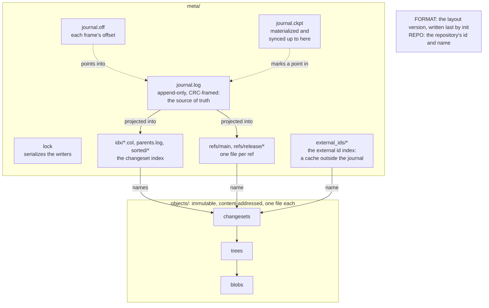
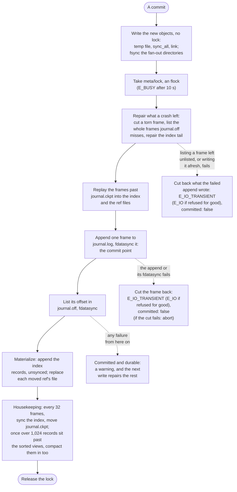
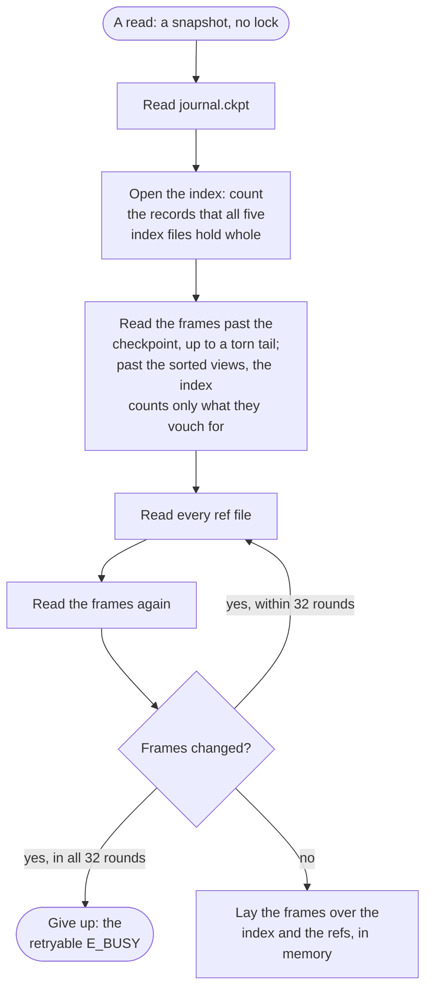

# SwarmOps architecture

An overview, in English, of how SwarmOps is built, as of M5. The design specs are the
authority. They are in Korean, and the maintainers keep them privately; this page is the
public overview of:

- the umbrella spec ("umbrella" below),
- storage core ("storage"),
- operations and landing ("operations"),
- the review model.

Section signs (§) point into the spec named beside them. Where this page and a spec disagree,
the spec is right and this page has a bug.

## What SwarmOps is

SwarmOps is source control for a swarm of coding agents on one host (and, from M11,
offline-first across hosts): 10 to 50 Claude Code or LangGraph processes working in one
repository at once (umbrella §1). It adapts several principles that Anthropic described for its
in-house system Scion, in the post "Redesigning source control at Anthropic"
(https://www.anthropic.com/research/redesigning-source-control, 2026-10-13), to a single
host; others, such as horizontal scaling, lock-free commits and always-online clients across
hosts, do not carry over. SwarmOps is an independent project, not affiliated with or endorsed by
Anthropic, and contains no Scion code, which is not public. It is not meant as a
general-purpose git replacement. Its main users are LLM agents, so every operation is a library
function and the command line is a thin shell that prints JSON. It is fully embedded: one
program, no external database, no daemon.

M0 (bootstrap), M1 (the single-agent core), M1.5 (hardening and opening), M1.6 (the
code-review follow-ups), M2 (diff, history and the derived-data engine), M3 (git import), M4
(merge and landing, and the operation log with undo), M8 (git export), M13 (git remotes) and M5
(workspaces) are done, but for work of M1.6, M2, M3, M4 and M8 that waits until after the pilot. Since M1,
SwarmOps is usable by one agent: its store takes commits from many processes at once, safely.
Since M4, `land` merges an agent's change three-way onto a ref and publishes it, not yet measured
under a swarm's load. Since M13, a store clones, fetches, pushes and syncs a git remote such as
GitHub itself. Since M5, an agent builds and tests its change in a workspace on disk and lands
the tree it tested. Review (M7) comes later, in the order of umbrella §13.
[known-limitations.md](known-limitations.md) lists what M1, M1.5, M1.6, M2, M3, M4, M8, M13 and M5
leave open.

## Crates and layering

| Crate | What it holds |
| --- | --- |
| `swarmops-core` | Object ids, repository paths and the canonical object codec. It does no I/O; its byte layouts are the hash contract. |
| `swarmops-store` | The loose object files (`FsObjectStore`), the store's layout (`Layout`), the native metadata store (`MetaStore`): the journal, the writer lock, the changeset index and the ref files; and the cache of derived values beside it (`DerivedStore`). The object store's filesystem access, every metadata write and the derived values' reads and writes go through the `FsOps` seam, which the crash tests hook. |
| `swarmops-merge` | Pure algorithms over trees and lines, with no I/O and no store: the tree diff (leaf-level changes, canonical deltas and three-way path entries) and the line diff (histogram hunks, by `imara-diff`) from M2, and the three-way merge from M4. `swarmops-repo` re-exports it as `swarmops_repo::merge`. |
| `swarmops-git` | git's side of the import, from M3, and of the export, from M8: git's commit and tree bytes parsed into their fields and rendered back byte for byte (`raw`), the ids git gives objects (`GitOid`, `git_hash`), and `GitSource`, what the import reads from a repository: refs resolved to commits, and objects' bytes, each checked against its id. `GixSource` reads a repository on disk through gix, pinned and seen by that one module, so that git2 could replace it there. `Converter` turns git's commits, trees and blobs into a changeset's fields, trees and blobs, and checks that a commit it took without loss renders back to its own id (`render`); what a changeset cannot hold is refused by class (`LossyClass`) unless the import allows the class. `import` brings every commit a git ref reaches that a store does not hold into it, parents first and many to a journal frame, and moves a target ref to the tip's changeset; run again, it takes only what is new (below, "Git import"). The export, from M8, writes a store's history behind a ref into a git branch through `GitSink` (`GixSink` on disk), and `ExportOid` names the commit each changeset exports to (below, "Git export"). From M13, the git remotes' library side (below, "Git remotes"): `Mirror`, the store's git mirror and its lock; `Transport`, whose one implementation `GitCli` runs the user's git against the mirror and classifies its failures; the sync engine (`sync`), which finds the unpublished changes, those the remote holds already, and lands the rest onto the remote's head; and GitHub's limits (`limits`). From M14, the server's git side (`serve`): the map between store refs and git refs (`refmap`), the serving repository `git/serve.git` and its lock (`repo`), the host git's `upload-pack`, `receive-pack` and `http-backend` run on it (`child`), git's pkt-lines and its `proc-receive` protocol (`pkt`, `proc_receive`), and the land key of a push to `refs/land/<target>` (`land_key`). |
| `swarmops-repo` | The repository engine, the "server" of the design (storage §4): commits from change lists, reads at a revision without a checkout, revision resolution, first-parent history, ref moves by compare-and-swap, `verify`, and the derivation engine, which derives values from the immutable objects when they are asked for and caches them in `meta/derived/` (`Repo::derived`), the eager ones also ahead of any reader as the journal grows (`Repo::derive_eager`, which `swarmops derive` runs). `LocalRepo` is a `Repo` on the local filesystem. |
| `swarmops-api` | The operation contract: serde and JSON Schema types for every request and response, `OpError` and its `ErrorCode` table, the `Envelope`, `Identity`, and the `StoreOps` trait. |
| `swarmops-ops` | `LocalOps`, which implements `StoreOps` over a local store: it resolves revisions, identities and change-list contents, calls the repository, and maps every failure to an `E_*` code. Beside them, `git import` and `git export`, client-side operations that no `StoreOps` has: they run `swarmops-git`'s import and export on a repository of the caller's host; and, from M13, the git remotes' client-side operations, `clone`, `remote add|remove|list`, `fetch`, `push`, `sync` and `sync status`, and the signing addresses of `authors.toml`. From M14, `serve`, the server for stock git clients: its ssh and CGI entries, the store's `access.toml` and the caller's identity, the refresh of `git/serve.git` from committed snapshots, the `proc-receive` hook that decides each pushed ref (import, access, compare-and-swap, `refs/land/<target>`), and a guard that masks host paths in what a client reads and refuses `{"file"}` content. |
| `swarmops-ws` | The workspaces, from M5 (operations §2): a client-side engine over `dyn StoreOps` that writes a sparse copy of a changeset's tree into a directory (`HostFs`), finds edits by stat and an index (`index.bin`, a cache), commits them, rebases and lands them (`ws land --check` lands the tree its check ran on), and keeps its durable files (`workspace.json`, the intent records, the registry `<store>/workspaces/`) through the store's `FsOps`. It also holds the Claude Code hook adapter and the bootstrap. |
| `swarmops-cli` | The `swarmops` binary and `so`, its short form (the same program): one subcommand per operation, exactly one envelope per run on stdout, but for `mcp`, `serve` and `derive --follow`. |
| `swarmops-testkit` | The support the tests share: `FsOps` doubles, power-loss images, the child-process runner with deadlines, builders of stores, repositories and runs of the binary, from M13, git remotes without the network: git's own `http-backend` served on loopback and a stand-in for ssh; and, from M5, a synthetic workspace tree and its edit driver. A dev-dependency of the store, the repository, the operations, the CLI, the git crate and the workspaces, and a dependency of the fuzz targets, which take it without its default features `cli`, `git` and `repo` (the runs of the binary, the git fixtures and the repository builders); no product build includes it. |

Dependencies point one way, from the binary down to the codec, the test kit's dev edges aside:

```text
swarmops-core    depends on no SwarmOps crate
swarmops-api     depends on no SwarmOps crate
swarmops-store   core
swarmops-merge   core
swarmops-repo    core, merge, store
swarmops-git     core, repo, store
swarmops-ops     api, core, git, repo, store
swarmops-ws      api, core, merge, store (FsOps only)
swarmops-cli     api, ops, ws        (its tests also use core, repo, store and testkit)
swarmops-testkit core, store, repo   (repo behind its default feature `repo`; a dev-dependency
                                      of store, repo, ops, cli, git and ws, and fuzz/'s dependency)
```

`fuzz/` is a cargo workspace of its own, with eight cargo-fuzz targets over the codec, object
files, the journal of each `FORMAT` and FORMAT 2's ref files. The specs plan one more crate, `swarmops-sim` (the simulation harness, M9).

Two rules shape the layers (umbrella §1, [CONTRIBUTING.md](../CONTRIBUTING.md#the-rules)):

- **The library does the work.** Every operation is a library function: the repository's work
  is in `swarmops-repo`, exposed as `StoreOps` operations, and the CLI parses a command line,
  calls the operation and prints the result.
- **Store-facing types carry no filesystem paths.** Every operation takes and returns serde
  types, so `StoreOps` is the seam a remote client and a server will share: M11's sync, over
  `ssh <host> swarmops serve --stdio`, and an RPC server, a follow-up after v1 (operations §7,
  umbrella §17). The four exceptions are client-side: a change's `{"file": "<path>"}` content,
  which is read on the client, in the caller's process; `init`'s path (`init` is not a
  `StoreOps` operation); `git import`'s source repository (`GitImportReq.git_path`), which the
  caller's process reads; and `git export`'s destination repository (`GitExportReq.git_path`),
  which the caller's process writes: neither `git import` nor `git export` is a `StoreOps`
  operation or an MCP tool, and no server receives their requests (operations §0, §7). `clone`'s
  directory (`CloneReq.path`) is a fifth, since `clone` includes `init`. A remote's URL is no path,
  but it appears only in the requests that write `remotes.toml` (`CloneReq`, `RemoteAddReq`) and
  in `RemoteInfo`; `fetch`, `push`, `sync` and `sync status` take a remote by its name. The
  workspace operations (M5) are client-side too, as `git import` is: their requests carry host
  paths as strings (`WsCreateReq.path`, `.from`), and they reach the store only through
  `StoreOps` (operations §0, §2). This is
  also why `swarmops-api` and `swarmops-repo` each have their own `ChangeOp`, `RepoInfo` and
  `VerifyReport`: the first are the wire format, the second the domain, and `swarmops-ops`
  converts between them.

## Data model

Three kinds of immutable, content-addressed objects (storage §1, umbrella §5):

- A **blob** is a file's content, raw bytes. A symlink's target is a blob too; the executable
  bit lives in the tree entry.
- A **tree** is one directory: entries sorted by the bytes of their names, each a kind (File,
  Exec, Symlink or Dir), a name and an id. There are no empty directories; only the root tree
  may be empty.
- A **changeset** is one commit: its parents (`parents[0]` is the mainline), `root` (the id of
  the whole resulting tree), `delta` (what changed against `parents[0]`, sorted by path: a `Put`
  of a kind and an id, maybe renamed from another path, or a `Delete`), git-style author and
  committer signatures, the message as bytes, `extra_headers` (git headers verbatim and in
  order) and `metadata` (keys SwarmOps owns, such as the committing agent).

A changeset carries both the full root and the delta. The root makes a read O(depth) object
reads without a checkout, lets a tree diff skip unchanged subtrees, and makes verification
cheap; the delta keeps a commit's cost proportional to the size of the change (storage §0).
`delta_hash`, the hash of the encoded delta, recognizes the same change on another base; the
index keeps it for the landing and review rules to come.

An id is `blake3("swarmops:<kind>:v1\0" ++ u64le(payload_len) ++ payload)`: 32 bytes, printed as
64 lowercase hex digits (input may use either case), and on the command line any unique prefix
of 12 digits or more. The id does not encode the kind (as in git), though the kind's domain
string is hashed; distinct types (`BlobId`, `TreeId`, `ChangesetId`) keep ids apart in the code.

These layouts and this recipe are **the hash contract**: they never change in place, and a new
layout gets a new kind/version header. The golden vectors in
`crates/swarmops-core/tests/golden/` pin the bytes and ids of representative objects. The codec
refuses every non-canonical encoding (unsorted or duplicate entries, overlong varints, trailing
bytes, invalid names or paths), so each object has exactly one valid byte string.

A repository path is validated UTF-8: `/`-separated, with no empty, `.` or `..` component, no
leading or trailing `/` and no NUL. Paths compare as bytes and are never normalized, so two
Unicode spellings of a name are two paths. A file's content is at most 512 MiB, a commit's
contents at most 1 GiB together, and a request's text (a change list, an MCP message) at most
64 MiB, each measured before it is read.

## The store on disk

A store is one directory (storage §2, §3):

```text
<store>/
  FORMAT                     "swarmops-store 2\n" (or 1), written last by init: a store without it was never finished
  REPO                       the repository's id and name
  objects/tmp/               where new object files are staged
  objects/<2 hex>/<62 hex>   one file per object: a header ("SOB1", kind, encoding, length), then the payload
  meta/lock                  the lock that serializes metadata writers
  meta/maint.lock            the maintenance lease (M6): one gc, repair or upgrade at a time
  meta/journal.log           append-only, CRC-framed journal: one frame per write transaction, the source of truth
  meta/journal.off           each frame's start offset, so frame n is found at once
  meta/journal.ckpt          how far the journal is materialized and synced
  meta/idx/*.col             the changeset index, one column per field (id, generation, delta hash, parents)
  meta/parents.log           the parents the index points into
  meta/sorted/*.{key,rec}    sorted views of the index, by id and by delta hash, for searching
  meta/refs/main             one file per ref ("<64 hex>\n<version>\n"); also meta/refs/release/<name>
  meta/journal2.{log,off,ckpt}  FORMAT 2's journal, offsets and checkpoint, in place of journal.* (M6)
  meta/refs2/<32 hex>        FORMAT 2's ref files, in place of meta/refs/ (M6): named by the name's hash, holding it
  meta/derived/<name>/...    derived values, one file each: a cache beside the journal, never synced (M2)
  meta/derived/tmp/          where new derived values are staged
  meta/external_ids/         the external id index (M3): <system>/<2 hex>/<rest of the hex>, one 44-byte file per id
  remotes.toml               the git remotes (M13): written whole, under git/lock, by remote add|remove and clone; no credential
  authors.toml               optional (M13): an agent family's commit address and name; a person writes it
  git/MIRROR                 "swarmops-git-mirror 1\n" (M13): the mirror's own layout version, apart from FORMAT
  git/lock                   the mirror's lock (M13): one clone, remote add|remove, fetch, push or sync at a time
  git/mirror.git/            the git mirror (M13): a bare git repository, a cache that SwarmOps alone writes
  git/SERVE                  "swarmops-git-serve 1\n" (M14): the serving repository's layout version
  git/serve.lock             serve's lock (M14): held while a ref of serve.git moves, waited for up to 10 s
  git/serve.git/             the serving repository (M14): bare, a cache of exports that `serve` runs git on
  git/serve-hooks/           its one proc-receive hook (M14), a sh file that starts `serve --hook`
  access.toml                optional (M14): who may read, push, force (a backward move or a deletion) and land through `serve`; a person writes it
  quarantine/objects/<64 hex>  object files repair found damaged (M6), set aside, never deleted
```

Objects are compressed one at a time with zstd at level 3, with zstd's content checksum, when
they hold at least 128 bytes and compression makes them smaller; otherwise they are stored raw.
Ids always hash the raw content.

The index and the ref files are projections of the journal. A journal frame is
`u32le len | u32le crc32(payload) | payload`, and its payload holds fixed-width little-endian
records: a changeset entering the index, a ref move, a compaction marker. The frame layout and
the record layouts are the disk contract of `FORMAT 1`: not part of the hash contract, but
changed only with a new `FORMAT` (storage §3). `FORMAT 2` (M6) keeps the records and changes the
frame header to `u32le len | u32le crc32(payload) | u64le seq | u32le prev_crc | u32le
crc32(header)`, gives each `journal.off` entry the frame's payload CRC and a checksum of its own,
and names each ref file `hex(blake3("swarmops:refname:v1\0" ++ name)[0..16])`, which holds the
name; that recipe names files, and is no part of the hash contract. Derived values (M2) are no projection of the
journal but a cache beside it, with a header of their own (below). The external id index (M3,
storage §7) says which changeset an id of another system names, a git commit's oid say: an immutable
file per id, written as an object is and only once the frame that records its changeset is durable.
It is a cache outside the journal, not a projection of it, so it leaves `FORMAT 1` as it is. Later
milestones add reviews (M7) to `meta/`. The workspace registry (M5), `workspaces/<name>.json`,
sits beside `meta/`: only the client-side workspace operations read and write it, no store
operation does.

How the files depend on one another:



## Writing

**Objects** (storage §2, rule 1). A new object is written to a temp file in `objects/tmp/`,
synced (`sync_all`), and hard-linked into `objects/<2 hex>/<62 hex>` without replacing anything:
if the name exists, the content is the same, and the temp file is dropped. A flush then fsyncs
each fan-out directory the batch touched, once and in parallel, and `objects/` itself if a new
fan-out directory appeared. Object writes take no lock and repeating one changes nothing.

**Derived values** (storage §3, §5). A value derived from immutable objects is cached in a file
of its own, `meta/derived/<name>/<version>/<2 hex>/<62 hex>`: the derivation's name and version,
then the object the value is about, with 16 hex digits of BLAKE3 of the value's key appended when
it has one. The file is written to a temp file in `meta/derived/tmp/` and hard-linked into place
without replacing anything, as an object is, but nothing is synced and no lock is taken: no
journal record or other file names a derived value, so a power loss that takes one back, or
leaves its file torn, costs a recomputation and nothing else. Each file holds its value's key
(`SWDV` header, then the key and the value, zstd over 4 KiB) and ends in a BLAKE3 trailer over the
slot (name, version, object, key) and the value. A read that finds a file failing any of those
checks removes it and reports the value missing, so that it is derived again; so does a header
that records a value longer than an object holds (512 MiB), before anything is decoded. The
trailer is a checksum, not a signature: anyone who can write the store's files can place a whole
file with any value. So the walks and path history check each value they use against the index
and the objects where they can without the walk the value saves, and refuse one that fails
(`RepoError::DerivedCorrupt`, `E_STORE_CORRUPT`); `verify --deep` checks every value of the
built-in derivations against the objects (`derived_mismatch`).

**Deriving a value** (storage §5). A `Derivation` says how one kind of value is made from a
changeset and a key, out of objects and other derived values only (never a ref, the journal or
the clock), so that a value never changes once derived: its name and version (its directory), the
values it depends on (by default its parents', under the same key), an optional `canonical`
redirect to a cheaper node of the same value, and `derive` itself. A repository's `Registry` holds
the derivations it knows (`Repo::register`). `Repo::derived` reads a value back if the store holds
it; otherwise the engine derives it, with every value it needs that the store lacks, and stores
each. The engine never recurses on the Rust stack: it keeps an explicit stack of nodes
(derivation, changeset, key) and evaluates bottom-up, deriving first a node's missing
dependencies, and any value `derive` reads and finds missing (`DeriveError::Missing`), before it
calls `derive` again. A redirect stores nothing, except that a derivation with `MEMO_EVERY = n`
stores, for a chain of more than n redirects, the end's value at the chain's start and every n
steps along it, so that a later walk is short. A node met again while it is on the stack is a
cycle, an error (`RepoError::Derived`, `E_INTERNAL`: a derivation that fails on immutable inputs
fails every time). A put that fails is dropped: the run keeps the value in memory, and returns it.

**Eager derivations** (storage §5). A derivation marked eager, whose key is `()`, is also derived
ahead of any reader: today the built-in `FirstParentSkipList`, each changeset's first-parent
ancestors 1, 2, 4, … steps back. `swarmops derive` (`StoreOps::derive`, over `Repo::derive_eager`)
reads the journal's frames after a given frame, at most 1,000 by default, and derives the eager
values of each changeset they record, in journal order, so that a changeset's parents have theirs
first; it reports how many values it derived, how many the store held already, and `next`, the last
frame it read, after which the next call goes on. `swarmops derive --follow` runs until it is
killed, from the journal's end (from its first frame with `--from-start`, or after `--after N`): it
looks again every `--interval-ms` once it has caught up, and prints one envelope a line for each run
that derived something. A commit derives nothing, so commits keep their latency and their filesystem
calls, and a value no follower has derived yet is derived by the first reader that asks for it.
`derive` writes only the cache of derived values, so it needs no identity, and it has no MCP tool:
it is maintenance beside the store, no agent's work.

**Path history** (storage §5). The built-in derivation `LastModified` gives, for a changeset and a
path, the newest changeset on its first-parent chain, itself included, whose delta has an entry
at the path or below it. A changeset that does not touch the path redirects to its first parent,
so a value is derived only where the path changed (and at a root that never had it), and a chain
of more than 64 redirects stores its value every 64 steps, so that a later query walks at most 64
changesets. A path's history (`RepoRead::path_history`) chases that value: the last touch, then
the last touch from its first parent, each with what the path holds after it. `log_paths` lists
the changesets that touch any of several paths, newest first, from each path's chase along the
one chain.

**A commit** (`Repo::commit`; storage §2 rule 2, §3):

1. The request is checked, its blobs hashed, and the changed directories rebuilt in memory,
   bottom-up; then the changeset object is encoded. A blob a change names by its id
   (`{"blob": id}`, stored before by `blob_put`) is neither read nor hashed: its header says the
   store holds it, and the commit retains it.
2. The new blobs, trees and the changeset are written in one parallel batch and flushed, and the
   flush fsyncs the directories of the retained blobs too. Every object is durable before any
   metadata names it.
3. A metadata write transaction takes `meta/lock` (below), repairs what a crashed writer may
   have left (it cuts a torn journal tail, repairs the index tail, and replays the frames past
   `journal.ckpt` into the index and the ref files; what that repair did comes back in the
   envelope's `meta.recovered`), and queues the changeset for the index.
4. It appends one frame to `journal.log` and `fdatasync`s it: **this is the commit point**. A
   commit that returns survives a power loss. The frame's offset then goes into `journal.off`,
   synced too.
5. It materializes the frame: index records are appended without a sync, and the file of each
   ref the frame moves is replaced (temp file, fsync, rename, directory fsync).
6. Housekeeping, still under the lock: every 32 frames past the checkpoint (and on an explicit
   flush), the five index files are synced and `journal.ckpt` moves to the end of the journal.
   When more than 1,024 index records sit past the sorted views, a compaction merges them into
   the views after the sync, before the checkpoint moves.

The same steps, with what a failure on each side of the commit point leaves:



What a failure means depends on which side of the commit point it falls (storage §2 rule 3,
§3):

- **Before it**: a failed `journal.log` append or `fdatasync` leaves nothing committed. The
  writer, still holding the lock, cuts the journal back to where the frame began (`ftruncate`,
  then `fdatasync`; if nothing of the frame reached the file, there is nothing to cut) and
  returns the retryable `E_IO_TRANSIENT` with `details.committed = false`: the transaction
  definitely did not commit, and running the same command again is safe. (If the filesystem
  refused the append for want of permission or because it is read-only, the error is `E_IO`,
  not retryable, with the same `details.committed = false` and a hint that says what to fix
  first: running the command again meets the same refusal until then. So it is for the second
  and third ways below.) The frame is cut, not
  left for a later writer to sync and list, because Linux reports a failed writeback only once
  and may drop the unwritten pages: a later sync could succeed although the frame never reached
  the disk. If the cut itself fails, the process aborts rather than go on with a journal tail it
  cannot vouch for. A crash in the middle of the append leaves at most a torn frame, which the
  next writer cuts; a crash after the whole frame was written but before its `fdatasync`
  returned leaves a frame that the next writer syncs and lists, so that transaction did commit,
  though no one was told. If that writer's sync fails, no later sync could vouch for the frame
  either, so the writer writes the unlisted frames afresh from the bytes it read (it cuts them
  off, appends them again and syncs them) and lists them only then. Only if the rewrite fails
  too does the frame stay cut off; then that transaction did not commit, and neither did the
  writer's own, whose write fails with `E_IO_TRANSIENT`: the second way that error arises. The
  third: that writer's listing of such a frame in `journal.off` fails. It cuts what reached
  `journal.off` back off, and its own transaction, which never began, fails with
  `E_IO_TRANSIENT`; the frame stays whole, and the next writer lists it.
- **After it**: any failure once the `fdatasync` has returned (listing the frame in
  `journal.off`, materializing it, syncing the index, moving the checkpoint) leaves the
  transaction committed and durable. It is reported as a warning beside the result, and the
  next write repairs what is missing. A listing that fails is cut back off `journal.off` first,
  so that a power loss cannot leave a hole among the listed entries. One case escapes: a commit
  whose listing failed waits, unlisted, for the next writer to list it, and if that writer's
  sync and then its rewrite fail, or it crashes between its cut and its rewrite, the commit is
  lost. That takes three faults (storage §2 rule 3 lists the remaining double and triple faults).

Four double faults abort the process (`std::process::abort`, saying why on stderr) rather
than let it go on with state it cannot vouch for: a failed frame whose cut fails too, a cut
that fails while unlisted frames are written afresh, frames written afresh that land anywhere
but where they were (another writer's bytes came in between) and cannot be cut back, and an
`init` that cannot take its `FORMAT` back. A long-lived process, such as `swarmops mcp`, ends
with them, and its client sees it exit.

`init` (storage §2) writes `FORMAT` last and then syncs the store's root. If that sync fails, it
takes `FORMAT` back (removes it, and syncs the removal) and fails: the store is not complete,
and running `init` again finishes it. If the store is made but reading it back for the report
fails, the error says so with `details.created: true`.

**A ref move** is a compare-and-swap under the same lock (storage §3): the ref's current target,
after replay, is compared with the expected one. On a mismatch nothing is recorded and the
caller gets `E_CAS_MISMATCH` with the actual target in `details.actual`. On a match, the move
goes into the transaction's frame, and the ref file is replaced after the commit point. Refs are
`main` and `release/<name>`; the journal's ref moves are the reflog. A move to the target it
expects is compared the same way, under the lock, and records nothing either way: the ref holds
that target (a replay) or another (`E_CAS_MISMATCH`).

A move may share a commit's transaction (`commit --advance`, storage §4): the changeset and the
move of its ref are then one frame, one commit point, recorded together or not at all. The move
expects the commit's first parent (no ref at all, for a root commit), so it is always a one-step
fast-forward; when the ref names anything else, the transaction is dropped and nothing is
recorded (`E_CAS_MISMATCH`, `details.committed: false`), only the flushed objects remaining, for
GC. A publish so takes one lock pass and four syncs, where a commit and then a move take two and
six.

**A land's publish** (operations §3 step f) is that frame too: the land's changeset `L`, made and
flushed outside the lock on the head the land read, and the target's compare-and-swap from that
head. When the target moved in between, the writer holding the lock makes the land anew on the
new head instead of handing it back (metalog merge, the model the M4 measurement chose:
[perf.md](perf.md), "M4 — the landing model, measured"). It walks first parents from the new
head back to the old one, at most 256, and gathers the paths those changesets touched. When none
overlaps a path of `L` (equal to it, or a directory prefix of it either way), `L'` is `L`'s delta
on the new head's tree; an overlapping regular file of at most 1 MiB on all three sides is merged
three-way (diff3) in the lock. `L'`'s new trees, merged blobs and changeset object are written
and flushed under the lock, before the frame that names them. A longer or backward move, any
other overlap and a conflict drop the transaction instead: the lander merges again and retries.
A land with an expected target (`ws land --check`) is never made anew, so what lands is the tree
it checked. A relocated land holds the lock one object round longer.

## Reading

Readers take no lock (storage §3, "읽기"), `op log` aside (below). `MetaStore::read()` takes a snapshot: it reads
`journal.ckpt`, opens the index (counting only the records that all five index files hold whole,
and, past the checkpoint and the sorted views, only those that the frames past the checkpoint
vouch for, field by field, as storage §3, "색인의 보증", says: a record that a power loss zero-filled
is not counted, the snapshot reads its changeset from the frame, and the next write replays it;
with no journal to read, or a damaged one, it counts those records by the files' lengths instead,
an index whose `par.col` entries there break their layout does not open, and `verify` reports the
journal's damage),
reads every frame past the checkpoint (whole frames not yet listed in `journal.off` included; it
stops at a torn tail), reads every ref file, then reads the frames again, and if they are not the
frames it read (new ones, or a frame a failed sync or rewrite cut back and the next writer
replaced at its seq), reads the refs and frames again. It then lays the frames past the
checkpoint over the index and the refs in memory. Writers replace a ref file only after its
frame is whole, so the refs it reads never run ahead of the frames it read. It makes at most 32
such rounds of reading the refs and the frames (`MetaStore::SNAPSHOT_ROUNDS`): when the frames
changed in every round, commits kept landing as it read, and it gives up with the retryable
`E_BUSY` rather than wait for them to stop. A `journal.off` that holds fewer entries when the
frames are read than when it was measured is no damage: a writer cut an entry that was never
genuine (one whose own sync failed, or zeroed ones a crash left at its end), and every reader of
the journal (the snapshot's rounds, paging, `reflog`, `verify`) measures it again and reads on.

`op log` is the one local reader that takes the lock: it reads the committed snapshot
(`MetaStore::read_committed`, as the git export below does), so that a frame a failed sync or a
power loss takes back is never listed, and a number it lists is never given to another operation.



A lookup by id searches the sorted view, one 32-byte key per `read_at` on the file (there is no
mmap: `unsafe` is forbidden). Ids are BLAKE3 hashes, spread evenly, so the search interpolates on
their first 8 bytes and reads 4 to 6 keys at 100,000 to 1,000,000 changesets; it bisects where
that does not help, and never reads more than twice the keys a bisection would. Then come a
linear scan of the records past the view and the in-memory frames; a lookup reads about a dozen
small byte ranges. Files and directories at a revision are read from the trees, starting at the
changeset's root: O(depth) object reads and no checkout.
Every object read checks the object's header and hash.
A lookup checks what the index says where it can do so cheaply: the record a sorted view names
must hold the key looked up (one more `read_at`), and a record read by id must have its parents
start where the record before it leaves off; a lookup that finds either broken fails with
`E_STORE_CORRUPT` rather than answer with another changeset. A first-parent walk (`log`, a
revision's `~N`, ancestry and merge bases, path history, a land's squash) takes each parent from
the changeset's object, which its hash binds, not from the index, and a read that returns a
record with its object checks that the two name the same parents.

A request reads in one snapshot (storage §8, operations §4). `Repo::snapshot()` returns a
`RepoRead`; `LocalOps` takes one when an operation starts and resolves every revision and ref
of the request in it, and a `commit` checks its parent there too (`Repo::commit_in`), the
insert's own check under the lock staying the one that counts. A snapshot is never read after
the request's own write, and never kept from one request to the next: besides going stale, one
that counted index records which a writer then cut back after a failed sync fails its lookups
with an I/O error until a new one is taken. `Repo`'s own read methods each take a snapshot of
their own.

## Git import

`swarmops_git::import` (storage §7, umbrella §12) brings a git repository's history into a store.
It reads the repository through `GitSource` alone, and writes through the repository's raw
changesets (`Repo::raw_batch`), objects and external id index:

1. It resolves the source ref (`HEAD` by default) to the tip and reads the target ref (`main` by
   default). A target that exists must hold a git commit at its head (`git.oid`): the base the
   import goes on from. A native changeset on the target is a divergence unless an export of this
   store wrote it: a native head goes on from the commit it exports to (`ExportOid`), so that
   commits made in git on top of an export come back on the changeset they were made on.
2. It walks from the tip over every parent, on a stack of its own, and stops at the base and at
   each commit the external id index names a changeset of the store for. An entry that is
   damaged, or names a changeset the store lacks, is no stop: the commit is converted again, and
   the import warns.
3. The base must be the tip, and then nothing is written, or an ancestor of it: met by the walk,
   or found below the commits it stopped at through the store's own parents, pruned by
   generation. Otherwise the import fails with `E_GIT_IMPORT_DIVERGED`, and nothing is written.
   A base the tip reaches only through a merge's second parent is no divergence.
4. It converts the commits it did not know, parents first (`Converter`: each git tree and blob
   once, the base's own taken as converted already, so that an incremental run reads only what
   changed), stores their trees and blobs, and records them 8,192 changesets to a journal frame.
   Each frame's external ids are written once the frame is durable (W8). A compaction runs at
   most once a frame.
5. It flushes the metadata, so that the checkpoint passes its frames and no reader parses them
   again, and moves the target from its head to the tip's changeset by compare-and-swap; a move
   is flushed too. A swap that finds the target at the tip's changeset already, another import's
   doing, succeeds.

A store failure stops the import after the last frame that committed (a writer lock held for the
whole wait is retried three times), and so does a frame whose step after its commit point
failed: it never writes again after a failed sync. The same import run again resumes there,
since each commit it recorded is in the store and named by its external id entry (or warned of,
where the index kept another entry for it). A commit the conversion refuses stops it before the
frame that would hold that commit; the frames before stay recorded, though the refusal does not
count them. The import reads no object whole whose header says
it is longer than an object holds (512 MiB): a commit, a tree or an annotated tag it would parse,
or a blob it would store, is refused before a byte of it is read (`E_TOO_LARGE`, naming it).

`swarmops git import <path>` runs it: `LocalOps::git_import` in `swarmops-ops`, a client-side
operation like `init`, opens the repository at the path on the caller's host through
`GixSource`, after it has checked the target's name, and imports into the store that `--repo`
names, the ref move recorded for the caller's identity. It maps each failure to its code
(`E_GIT_NOT_A_REPO`, `E_GIT_REF_NOT_FOUND`, `E_GIT_UNSUPPORTED`, `E_GIT_READ`,
`E_GIT_IMPORT_LOSSY`, `E_GIT_IMPORT_DIVERGED`, `E_TOO_LARGE`, or the store failure's own, with how
far the import got), and reports what its writes repaired in `meta.recovered` when it succeeds
(a commit reports it on `E_CAS_MISMATCH` too).

## Git export

`swarmops_git::export` (storage §7, umbrella §12) writes the history behind a store ref into a
branch of a git repository. It writes through `GitSink` alone: `GixSink` on disk, where gix writes
the loose objects and the sink makes them durable and moves the branch by git's own lock
protocol.

1. It refuses a branch that a work tree has checked out, then reads the source ref's head
   (`main` by default) in a committed snapshot (`Repo::snapshot_committed`, over
   `MetaStore::read_committed`): taken under the writer lock after the journal's tail check, so
   that neither a power loss nor a failed sync's cut can take back what the export sends off the
   host.
2. It reads the branch (`main` by default) and the head's export oid, the derived value `git_oid`
   (`ExportOid`): the commit each changeset exports to. An imported changeset whose lineage
   SwarmOps did not change takes its `git.oid` without reading a tree; any other is rendered and
   hashed, the git oids of its trees and blobs memoized per object in the derived store. With
   the store's memo key (32 bytes the CLI keeps outside the store, in
   `$XDG_STATE_HOME/swarmops/memo-keys/<repo_id>.key`), the walk stops at a parent, tree or blob
   whose `_mac` memo's keyed MAC checks and reads nothing below it; without one, every export
   oid below the head is derived from the objects (the v0.6.0 design, D2).
3. A branch at the head's export is up to date. Otherwise a branch that exists must name the
   export of the head or of an ancestor of it, the base: found through the external id index, or
   along the head's first parents. Anything else stops the export with `E_GIT_EXPORT_DIVERGED`
   and its reason before anything is written; `force` moves the branch all the same, still by
   compare-and-swap.
4. It walks from the head over every parent, highest generation first, the base's history left
   out and a commit the repository holds in a pack trusted with all it reaches, and writes what
   it found parents first: for each commit, the trees and blobs its root holds that its first
   parent's root does not, then the commit, whose rendering must hash to its export oid. An
   object the repository lacks is written as a loose object; a loose one there already is read
   back, and written again if it is damaged.
5. Objects, then sync, then entries, then the branch: every object written or read back is
   fsynced with its fan-out directory; then the native commits' oids go into the external id
   index (W8: their changesets are committed); then the branch moves by compare-and-swap through
   `refs/heads/<branch>.lock`, synced before its rename and its directory after, with no reflog
   entry. A branch another writer moved meanwhile stops it there (`moved_during_export`), which
   leaves the objects, loose and unreached, and the entries, which are true.

It writes no journal frame: its store-side writes are derived values and external id entries, so
it needs no identity.

## Git remotes

The git remotes (M13, umbrella §12 and §13, operations §6, storage §7) put a git mirror between a
store and its remotes, and move packs with the user's own git:

```text
  the remote ◀──── git fetch / git push ────▶ git/mirror.git ◀── import, export (gix) ──▶ the store
  (GitHub)        the user's git, spawned       refs/remotes/<remote>/*                   main
                  with the user's credentials   refs/remote-tags/<remote>/*
                                                refs/heads/push/<remote>/*
                                                refs/incoming/<remote>/*
```

**The transport.** `GitCli` runs `git` (2.39 or later: `SWARMOPS_GIT`, else `PATH`) as a child
process, without a shell, with its arguments after `--end-of-options` and its configuration in
the environment (`GIT_CONFIG_COUNT`: `core.fsync=all`, an empty hooks directory, protocol version
2, git's fsck of every received object), never in its arguments. The child's environment loses the variables that point git at another
repository, git's tracing and the locale, and gains `GIT_DIR` (the mirror), `LC_ALL=C`,
`GIT_TERMINAL_PROMPT=0` and `GIT_ALLOW_PROTOCOL` (the remote URL's scheme alone); credential
helpers, `SSH_AUTH_SOCK`, `GIT_SSH_COMMAND` and proxy variables pass through. A remote's
`token_env` reaches git as an HTTP header scoped to the remote's URL, and is redacted, with its
base64 form, from whatever git prints before it enters an error. A failure is classified by one
table, from git's exit status, push's porcelain and git's messages under `LC_ALL=C`, into
`E_REMOTE_UNREACHABLE` (retryable), `E_REMOTE_REJECTED` and `E_REMOTE_DIVERGED`; a failure the table
does not know is `E_REMOTE_REJECTED` with the reason `unclassified`, never retried; an object
git's fsck refuses, or one a fetched ref reaches and the mirror lacks, is `bad_objects`. SwarmOps has no
network crate and writes no pack: gix stays on the disk side.

**The mirror.** `git/mirror.git` is a cache that SwarmOps alone writes: fetched packs land in it,
the import reads it (`GixSource`), and a push's export is written into it (`GixSink`). A remote's
state is the mirror's `refs/remotes/<remote>/<branch>`, so the remotes need no new store ref and
no new `FORMAT`. A mirror that is missing, has a marker this build does not know, or that gix
cannot open is moved aside as `git/mirror.git.broken-<unix ms>` and made again; one held by a dead
process's git lock files has those removed once they are older than ten minutes. `git/lock`
serializes the commands that write the mirror; a held lock is `E_BUSY` at once. `meta/lock`, the
store's writer lock, is never held across the network.

**Fetch, push and sync.** `fetch` has git fetch every branch and tag into the mirror's
`refs/incoming/<remote>/` alone, checks that every object their tips reach is there
(`git rev-list --objects --missing=error`), imports the followed branch's commits from its incoming
ref with no ref moved (`objects_only`; each object it reads is checked against its id), and only
then moves the tracking refs and tags to the incoming refs by compare-and-swap. A failed step
stops it before the move, so no tracking ref moves on a refusal; a crash between the import and the
move is finished by the next fetch. `push` exports a store ref onto
a staging branch set to what the last fetch saw (`refs/heads/push/<remote>/<branch>`), so that the
export only appends, and has git push it with `--force-with-lease` on that value: a compare-and-swap
on the remote, never forced. `sync` fetches, finds `main`'s changes above the newest changeset the
remote's head reaches, drops those the remote holds (a `SwarmOps-*` trailer line in a remote commit,
or a merge onto the remote's head that changes nothing), lands the rest one by one onto the
remote's head with `Repo::land_detached` (land's three-way merge, with no ref moved, the change's
land key and squashed ids copied), moves `main` by compare-and-swap, then pushes. The import's
and the export's contracts are unchanged: a commit fetched from git keeps its id through any
number of round trips, and a changeset made in the store exports to the same commit every time.

## Durability

Full fsync is the default and the only mode (umbrella §16, decision 5). An object is synced and
its directory fsynced before any journal frame names it; a transaction commits when its frame's
`fdatasync` returns; ref files and the checkpoint are replaced by temp file, fsync, rename and
directory fsync. The index is synced only in batches, which is safe because the journal holds
every record and replay restores what a crash took from the index. A `--durability fast` flag
exists only if [perf.md](perf.md) records a measurement that justifies it, and none does.

A failed sync of file data is never trusted to a later one: the journal and the index cut back
what it covered or write it afresh (storage §2 rule 3, §3), and an object's data is synced in a
fresh temp file before its name exists; a failed directory fsync is fail-stop on the filesystems
the store supports (storage §2 rule 5), so the object store's retry of one covers only an fsync
that never ran.

The price is measured in [perf.md](perf.md): about 4 ms per fsync on the reference host, and
about 21 ms for an uncontended durable commit through the binary. The umbrella spec's commit
target (5 ms plus 0.3 ms per file) counts no syncs; batching syncs is to be reconsidered by M2's
journal-sync decision, which waits until after the pilot.

Crash safety rests on four invariants (storage §3): a changeset enters the index only after its
parents (I1), and only after every object it references is durable; refs change only by
compare-and-swap, recorded in the same transaction (I2); objects and derived values are
immutable and idempotent (I3); and every multi-file change is one journal transaction under the
lock (I4). The tests that hold the code to them:

- **crash sweeps**: with the `test-hooks` cargo feature, `SWARMOPS_TEST_CRASH_AT=k` aborts the
  process at its k-th filesystem call through `FsOps`, as `kill -9` would. The sweeps do that
  for every k a dry run counts: in the journal's writes and recovery, the index's appends and
  compaction, the metadata store's creation and replay (ref files included), the repository's
  `create` and `commit`, and the binary's `init` and `commit`. Each time the store must open
  and verify clean;
- **I/O-error sweeps** (M1.5): `SWARMOPS_TEST_FAIL_AT=k` fails the k-th call instead, with an
  injected `EIO` or `ENOSPC`, once or for every write from then on. The store's sweeps do that at
  every call of a checkpointing and of a compacting transaction, and of the recovery after a
  crash; the binary's at every call of `init` and `commit`. Each outcome must be honest: a
  success is in the store and verifies clean, a failure committed nothing or says that it did
  (an `init` that made the store sets `details.created: true`) and is never `E_INTERNAL`,
  `E_IO_TRANSIENT` says `details.committed = false`, an abort is one of the documented ones, and
  the store takes the next write;
- **write-ordering checks** (M1.5): `SWARMOPS_TEST_ORDER_CHECK=1` checks every filesystem call
  against the store's write-ordering rules, W1 to W8 of storage §2 rule 4 (a frame is listed
  only once it is durable, a ref file changes only after its frame is durable, the checkpoint
  moves only over synced index records, objects are durable before a frame names them,
  `FORMAT` is linked last, an external id entry only once its changeset's frame is durable, and
  more), and panics at the first call that breaks one. Every run
  of the binary in the CLI tests has it on, and so do the store's and the repository's crash
  sweeps;
- **a model of fsync failures on Linux** (M1.5): the bytes a failed sync did not cover stay
  lost, even when a later sync succeeds; under it, the journal must never list a frame that is
  not on disk;
- **power-loss images** (M1.5): one recorded run (an `init`, commits, ref moves, a compaction, a
  checkpoint) is cut after each of its steps, and each cut gives disk images of what a power
  loss there may leave: unsynced data dropped, cut at 512 B or 4 KiB, zero-filled or with its
  first sector lost, and directory entries that no fsync covered reverted. Opened with the
  binary, each must hold a prefix of the run's transactions with every committed one in it, and
  verify clean;
- property tests and fuzz targets for the codec, object files, FORMAT 2's frames and ref files,
  and journal recovery in each `FORMAT`, FORMAT 1's checked against a model;
- multi-process tests through the binary (8 processes committing at once, 16 racing to move one
  ref), each ending with `verify --deep`.

The crash sweeps model a process crash, which leaves the kernel's page cache intact, and the
power-loss images a model of the disk rather than a real device ([known-limitations.md](known-limitations.md)).
Since M6 a literal `SIGKILL` kills `commit --advance` at random points on a real disk, and every
sweep runs once per `FORMAT`.

## Concurrency

- **Objects** need no lock: they are immutable, named by their hash and linked into place
  without replacing anything.
- **Metadata writers** take `meta/lock`, an `flock` (storage §3). The kernel releases it when a
  process dies, so a crash leaves no stale lock. A waiting writer queues in the kernel through a
  helper thread and gives up after `lock_timeout` (10 s), with the retryable `E_BUSY`. The queue
  is not strictly first-in, first-out, but the wait is bounded: with 32 processes making 1,000
  commits each through the binary, none got `E_BUSY` and the slowest commit took 918 ms
  ([perf.md](perf.md)).
- **Readers** take no lock (above). Under commits that land during every one of its 32 rounds,
  a snapshot gives up with the retryable `E_BUSY` instead of reading on.

What an agent sees (operations §4):

- `commit` only appends, and does not fail because of another agent: concurrent commits both
  succeed (short of a lock wait past `lock_timeout`, or a snapshot of its parents that meets a
  new commit in every one of its 32 rounds: the retryable `E_BUSY`). A commit with `advance`
  publishes, and so fails with `E_CAS_MISMATCH`, recording nothing, when its ref no longer names
  its parent.
- Refs move only by compare-and-swap. When several agents expect the same target, exactly one
  wins each round; the others get `E_CAS_MISMATCH` and `details.actual`.
- A read by changeset id is immutable, lock-free and cacheable. A ref named in a request is
  resolved once, and the envelope's `meta.resolved` says what it named. Every revision and ref
  one request names is resolved in the same snapshot.
- A reader may see a frame before its `fdatasync` has completed. A power loss, or a failed sync
  of that frame (which the writer then cuts back), can therefore take back state that a local
  reader returned. A mutation that names such state (a parent, a ref's expected or new target)
  is checked against the store as it is, and fails rather than build on what was taken back.
  The readers whose results leave the host (M8's git export, M11's `serve`) take a committed
  snapshot instead (`MetaStore::read_committed`): under the lock, after the journal's tail check,
  so that neither can take back what it returns, at the cost of a wait behind the current writer.
- `op undo` is a compare-and-swap too: it moves every ref the operation moved back to what it
  named before, in one transaction, only while each still names what the operation set (or
  what it named before, which is skipped); a ref moved since by another operation refuses it
  with `E_CAS_MISMATCH`, and nothing is written. It reads the operation's frame under its own
  write's lock, so it never undoes a frame that a failed sync took back.
- `main` moves only forward (the M15 design §4): `ref set` and `op undo` refuse, with
  `E_REF_PROTECTED` and nothing written, a move of `main` whose head is not a first-parent
  ancestor of the new target. `ref set` judges it on its snapshot before the compare-and-swap;
  `op undo` judges each move of `main` it queued on a snapshot read under its write's lock. The way
  back is a land of a change that reverts it.
- `land` publishes a change made on an older head: it merges the change three-way onto the
  target's head (`main` or a `release/*` ref), and inserts the result, one squashed changeset whose
  parent is that head, with the target's compare-and-swap to it in one transaction, the frame a
  `commit --advance` writes. A land whose target moved meanwhile is made anew on its new head
  under the lock where the paths allow (above, "Writing"); otherwise it merges again onto what
  the target gained, over its own paths, and tries again, waiting from its fourth attempt; a
  conflict is `E_CONFLICT`, with a report of each conflicting file, and records nothing. A keyed
  land run again finds its changeset on the target and replays it, decided under the store's
  lock. So an agent that loses a ref race lands its change rather than re-sending whole files,
  which would overwrite the winner's edits.

## The contract

Every operation is a function from a request type to a response type or an `OpError`, and every type
is serde and JSON Schema (draft 2020-12, by schemars). Requests and responses ignore fields they do
not know, so versions can differ (operations §0). `StoreOps` has nineteen operations: `repo_info`,
`commit`, `land`, `resolve_rev`, `blob_put`, `blob_has`, `read_file`, `read_tree`, `show`, `log`,
`path_history`, `diff`, `ref_list`, `ref_set`, `ref_delete`, `op_log`, `undo`, `verify` and
`derive`; `init`, `whoami` and `schema` live in the CLI. `op_log` shows the journal as the store's
operations, a frame each (storage §3), and `undo` moves an operation's refs back by
compare-and-swap, `main` only forward.

Every run of `swarmops` prints exactly one envelope on stdout (only `--help` and `--version` print
plain text, `mcp`, below, speaks MCP there instead, `serve` git's protocol, and `derive --follow`
prints one envelope a line for each run that derived something):

```text
{"ok": …, "op": …, "api": 1, "result": … | "error": {code, message, retryable, exit, details, hint}, "meta": {repo, elapsed_ms, resolved, auth, recovered}}
```

A failure's `code` is one of 50 stable `E_*` codes, from one table that also fixes each code's
exit code (0 success, 1 error, 2 usage, 3 conflict, 4 retryable, 5 identity or policy, 6 not
found) and whether retrying can help. `hint` is often the next command to run.
`swarmops schema` prints the JSON Schema of 162 types, and its snapshot test is where contract
changes are reviewed ([the versioning policy](policies/versioning-and-stability.md)).
`meta.recovered`, there only when a command's write repaired what an earlier writer left (a torn
journal tail cut, frames listed, index records cut, changesets and ref files replayed), says what
it repaired, in offsets and counts; it is no warning (operations §0).

An I/O failure (`E_IO`, `E_IO_TRANSIENT`, and the `E_STORE_CORRUPT` of a metadata file that does
not parse) names the file operation that failed and the store file it was on (`details.fs_op`,
`details.store_file`, relative to the store's root), never a host path but in two `E_IO`s that
operations §0 names: a symlink loop met while working out where the store's path leads
(`fs_op: "resolve"`), whose message names that path, and tempfile's giving up after 65,536
taken temp-file names, not met in practice. The errors that answer for the path a command was
given name it too, most of them made absolute against the working directory: `E_NOT_A_REPO` (no
store there, or a `FORMAT` or `REPO` this build does not read), `E_UNSUPPORTED_FS` (its message
and `details.path`), and `init`'s `E_EXISTS`.

A mutation needs an identity, `<family>/<instance>` (for example `agent/worker-17`), from
`--as` or `SWARMOPS_AGENT`, with `SWARMOPS_RUN_ID` for the agent's run; without one it fails with
`E_IDENTITY_REQUIRED`. M1 records identities without verifying them (`meta.auth` is `"trust"`).
Reads need none.

Responses are bounded for an agent's context: `read_file` returns at most `max_bytes` (1 MiB by
default), with a `next_offset` to read on from when it cuts; `read_tree`, `log`, `path_history`
and `diff` return pages, sized by default for a 64 KiB response, with an opaque cursor for the
next one (a `unified` diff's page also within `max_bytes` of its files, 32 KiB by default); and
`show` lists at most `max_changes` changes (400 by default) and says when it cut the list. A
`next_offset`, or the cursor of `read_tree` or `diff`, names a place and not a revision: an agent
pages at the full ids the first page resolved.

`swarmops mcp` (M1.5) serves the same operations to agents over the Model Context Protocol, on
stdio: one tool per `StoreOps` operation but `derive`, maintenance that `swarmops derive` runs
beside the store, and from M13 the five git remote operations that take a remote by its name
(`remote_list`, `fetch`, `push`, `sync`, `sync_status`; `clone` and `remote add|remove` stay in
the CLI); a tool's input schema is the request type's JSON Schema, kept a plain object (a
rule across fields that the type's schema states with a top-level `oneOf` goes into the description
and the server's own check) and with the `expected_old` of `ref_set` and `ref_delete` narrowed to a
full changeset id, and its result is the envelope the CLI prints.

## Where to read more

- Storage §1 for the byte layouts, §2 for the disk layout and crash rules, §3 for the journal,
  the index, the lock, reads and the ref compare-and-swap.
- Operations §0 for the envelope and the conventions, §1 for every operation planned and its
  errors, §4 for what agents can rely on under concurrency.
- [perf.md](perf.md) for every measurement, and the decisions taken on them.
- The milestone plans, which the maintainers keep privately with the design specs, and
  [CONTRIBUTING.md](../CONTRIBUTING.md) for how changes are made.
