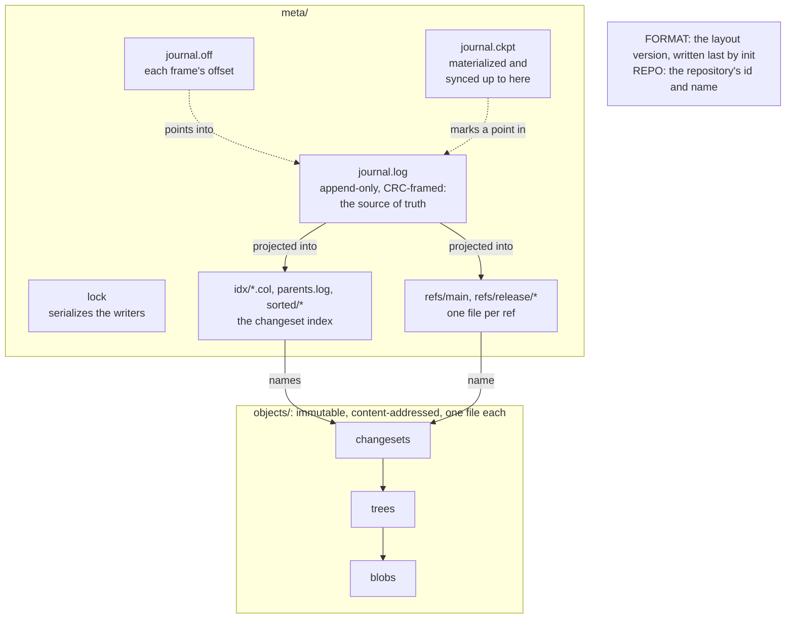
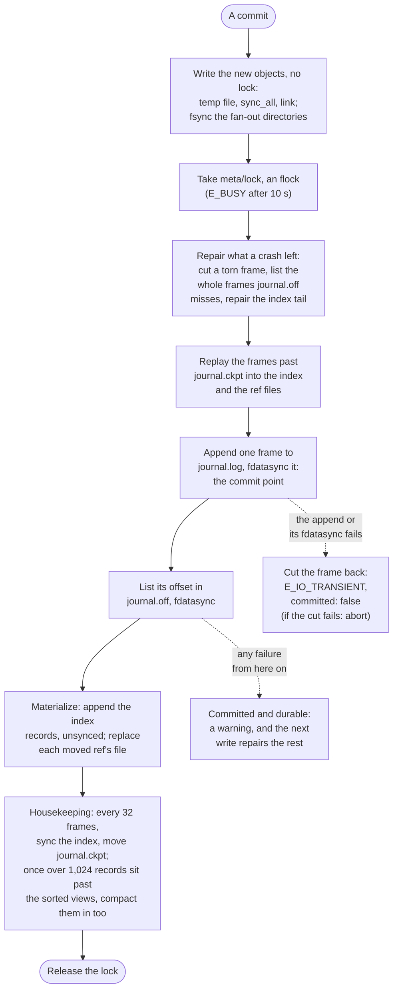

# SwarmOps architecture

An overview, in English, of how SwarmOps is built, as of M1.5. The design specs are the
authority, and they are in Korean:

- [the umbrella spec](superpowers/specs/2026-10-15-swarmops-design.md) ("umbrella" below),
- [storage core](superpowers/specs/2026-10-15-swarmops-storage-core-design.md) ("storage"),
- [operations and landing](superpowers/specs/2026-10-15-swarmops-operations-landing-design.md)
  ("operations"),
- [the review model](superpowers/specs/2026-10-15-swarmops-review-model-design.md).

Section signs (§) point into the spec named beside them. Where this page and a spec disagree,
the spec is right and this page has a bug.

## What SwarmOps is

SwarmOps is source control for a swarm of coding agents on one host (and, from M11,
offline-first across hosts): 10 to 50 Claude Code or LangGraph processes working in one
repository at once (umbrella §1). It takes the principles of Anthropic's Scion design
("Redesigning source control at Anthropic") to a single host, and is not meant as a
general-purpose git replacement. Its main users are LLM agents, so every operation is a library
function and the command line is a thin shell that prints JSON. It is fully embedded: one
program, no external database, no daemon.

M0 (bootstrap), M1 (the single-agent core) and M1.5 (hardening and opening) are done. Since M1,
SwarmOps is usable by one agent: its store already takes commits from many processes at once, safely, but
nothing merges yet. Merging and landing (M4), git import and export (M3, M8), workspaces (M5)
and review (M7) come later, in the order of umbrella §13.
[known-limitations.md](known-limitations.md) lists what M1 and M1.5 leave open.

## Crates and layering

| Crate | What it holds |
| --- | --- |
| `swarmops-core` | Object ids, repository paths and the canonical object codec. It does no I/O; its byte layouts are the hash contract. |
| `swarmops-store` | The loose object files (`FsObjectStore`), the store's layout (`Layout`), and the native metadata store (`MetaStore`): the journal, the writer lock, the changeset index and the ref files. The object store's filesystem access and every metadata write go through the `FsOps` seam, which the crash tests hook. |
| `swarmops-repo` | The repository engine, the "server" of the design (storage §4): commits from change lists, reads at a revision without a checkout, revision resolution, first-parent history, ref moves by compare-and-swap, and `verify`. `LocalRepo` is a `Repo` on the local filesystem. |
| `swarmops-api` | The operation contract: serde and JSON Schema types for every request and response, `OpError` and its `ErrorCode` table, the `Envelope`, `Identity`, and the `StoreOps` trait. |
| `swarmops-ops` | `LocalOps`, which implements `StoreOps` over a local store: it resolves revisions, identities and change-list contents, calls the repository, and maps every failure to an `E_*` code. |
| `swarmops-cli` | The `swarmops` binary and `so`, its short form (the same program): one subcommand per operation, exactly one envelope per run on stdout. |
| `swarmops-testkit` | The support the tests share: `FsOps` doubles, power-loss images, the child-process runner with deadlines, and builders of stores, repositories and runs of the binary. A dev-dependency of the store, the repository, the operations and the CLI; no product build includes it. |

Dependencies point one way, from the binary down to the codec, the test kit's dev edges aside:

```text
swarmops-core    depends on no SwarmOps crate
swarmops-api     depends on no SwarmOps crate
swarmops-store   core
swarmops-repo    core, store
swarmops-ops     api, core, repo, store
swarmops-cli     api, ops            (its tests also use core, repo, store and testkit)
swarmops-testkit core, repo, store   (a dev-dependency of store, repo, ops and cli)
```

`fuzz/` is a cargo workspace of its own, with four cargo-fuzz targets over the codec and the
journal. The specs plan three more crates: `swarmops-merge` (its tree diff serves M2's `diff`,
and its three-way merge M4's landing), `swarmops-git` (git import and export, M3 and M8) and
`swarmops-sim` (the simulation harness, M9).

Two rules shape the layers (umbrella §1, AGENTS.md):

- **The library does the work.** Every operation is a library function: the repository's work
  is in `swarmops-repo`, exposed as `StoreOps` operations, and the CLI parses a command line,
  calls the operation and prints the result.
- **Store-facing types carry no filesystem paths.** Every operation takes and returns serde
  types, so `StoreOps` is the seam a remote client and a server will share: M11's sync, over
  `ssh <host> swarmops serve --stdio`, and M10's RPC server (operations §7). The two exceptions
  are client-side: a change's `{"file": "<path>"}` content, which is read on the client, in the
  caller's process, and `init`'s path (`init` is not a `StoreOps` operation). This is also why
  `swarmops-api` and `swarmops-repo` each have their own `ChangeOp`, `RepoInfo` and
  `VerifyReport`: the first are the wire format, the second the domain, and `swarmops-ops`
  converts between them.

## Data model

Three kinds of immutable, content-addressed objects (storage §1, umbrella §5):

- A **blob** is a file's content, raw bytes. A symlink's target is a blob too; the executable
  bit lives in the tree entry.
- A **tree** is one directory: entries sorted by the bytes of their names, each a kind (File,
  Exec, Symlink or Dir), a name and an id. There are no empty directories; only the root tree
  may be empty.
- A **changeset** is one commit: its parents (`parents[0]` is the mainline), `root` (the id of
  the whole resulting tree), `delta` (what changed against `parents[0]`, sorted by path: a `Put`
  of a kind and an id, maybe renamed from another path, or a `Delete`), git-style author and
  committer signatures, the message as bytes, `extra_headers` (git headers verbatim and in
  order) and `metadata` (keys SwarmOps owns, such as the committing agent).

A changeset carries both the full root and the delta. The root makes a read O(depth) object
reads without a checkout, lets a tree diff skip unchanged subtrees, and makes verification
cheap; the delta keeps a commit's cost proportional to the size of the change (storage §0).
`delta_hash`, the hash of the encoded delta, recognizes the same change on another base; the
index keeps it for the landing and review rules to come.

An id is `blake3("swarmops:<kind>:v1\0" ++ u64le(payload_len) ++ payload)`: 32 bytes, printed as
64 lowercase hex digits (input may use either case), and on the command line any unique prefix
of 12 digits or more. The id does not encode the kind (as in git), though the kind's domain
string is hashed; distinct types (`BlobId`, `TreeId`, `ChangesetId`) keep ids apart in the code.

These layouts and this recipe are **the hash contract**: they never change in place, and a new
layout gets a new kind/version header. The golden vectors in
`crates/swarmops-core/tests/golden/` pin the bytes and ids of representative objects. The codec
refuses every non-canonical encoding (unsorted or duplicate entries, overlong varints, trailing
bytes, invalid names or paths), so each object has exactly one valid byte string.

A repository path is validated UTF-8: `/`-separated, with no empty, `.` or `..` component, no
leading or trailing `/` and no NUL. Paths compare as bytes and are never normalized, so two
Unicode spellings of a name are two paths. A file's content is at most 512 MiB.

## The store on disk

A store is one directory (storage §2, §3):

```text
<store>/
  FORMAT                     "swarmops-store 1\n", written last by init: a store without it was never finished
  REPO                       the repository's id and name
  objects/tmp/               where new object files are staged
  objects/<2 hex>/<62 hex>   one file per object: a header ("SOB1", kind, encoding, length), then the payload
  meta/lock                  the lock that serializes metadata writers
  meta/journal.log           append-only, CRC-framed journal: one frame per write transaction, the source of truth
  meta/journal.off           each frame's start offset, so frame n is found at once
  meta/journal.ckpt          how far the journal is materialized and synced
  meta/idx/*.col             the changeset index, one column per field (id, generation, delta hash, parents)
  meta/parents.log           the parents the index points into
  meta/sorted/*.{key,rec}    sorted views of the index, by id and by delta hash, for binary search
  meta/refs/main             one file per ref ("<64 hex>\n<version>\n"); also meta/refs/release/<name>
```

Objects are compressed one at a time with zstd at level 3, with zstd's content checksum, when
they hold at least 128 bytes and compression makes them smaller; otherwise they are stored raw.
Ids always hash the raw content.

The index and the ref files are projections of the journal. A journal frame is
`u32le len | u32le crc32(payload) | payload`, and its payload holds fixed-width little-endian
records: a changeset entering the index, a ref move, a compaction marker. The frame layout and
the record layouts are the disk contract of `FORMAT 1`: not part of the hash contract, but
changed only with a new `FORMAT` (storage §3). Later milestones add derived data (M2), the git
id mapping (M3), workspaces (M5) and reviews (M7) to `meta/`.

How the files depend on one another:



## Writing

**Objects** (storage §2, rule 1). A new object is written to a temp file in `objects/tmp/`,
synced (`sync_all`), and hard-linked into `objects/<2 hex>/<62 hex>` without replacing anything:
if the name exists, the content is the same, and the temp file is dropped. A flush then fsyncs
each fan-out directory the batch touched, once and in parallel, and `objects/` itself if a new
fan-out directory appeared. Object writes take no lock and repeating one changes nothing.

**A commit** (`Repo::commit`; storage §2 rule 2, §3):

1. The request is checked, its blobs hashed, and the changed directories rebuilt in memory,
   bottom-up; then the changeset object is encoded.
2. The new blobs, trees and the changeset are written in one parallel batch and flushed. Every
   object is durable before any metadata names it.
3. A metadata write transaction takes `meta/lock` (below), repairs what a crashed writer may
   have left (it cuts a torn journal tail, repairs the index tail, and replays the frames past
   `journal.ckpt` into the index and the ref files), and queues the changeset for the index.
4. It appends one frame to `journal.log` and `fdatasync`s it: **this is the commit point**. A
   commit that returns survives a power loss. The frame's offset then goes into `journal.off`,
   synced too.
5. It materializes the frame: index records are appended without a sync, and the file of each
   ref the frame moves is replaced (temp file, fsync, rename, directory fsync).
6. Housekeeping, still under the lock: every 32 frames past the checkpoint (and on an explicit
   flush), the five index files are synced and `journal.ckpt` moves to the end of the journal.
   When more than 1,024 index records sit past the sorted views, a compaction merges them into
   the views after the sync, before the checkpoint moves.

The same steps, with what a failure on each side of the commit point leaves:



What a failure means depends on which side of the commit point it falls (storage §2 rule 3,
§3):

- **Before it**: a failed `journal.log` append or `fdatasync` leaves nothing committed. The
  writer, still holding the lock, cuts the journal back to where the frame began (`ftruncate`,
  then `fdatasync`; if nothing of the frame reached the file, there is nothing to cut) and
  returns the retryable `E_IO_TRANSIENT` with `details.committed = false`: the transaction
  definitely did not commit, and running the same command again is safe. The frame is cut, not
  left for a later writer to sync and list, because Linux reports a failed writeback only once
  and may drop the unwritten pages: a later sync could succeed although the frame never reached
  the disk. If the cut itself fails, the process aborts rather than go on with a journal tail it
  cannot vouch for. A crash in the middle of the append leaves at most a torn frame, which the
  next writer cuts; a crash after the whole frame was written but before its `fdatasync`
  returned leaves a frame that the next writer syncs and lists, so that transaction did commit,
  though no one was told. If that writer's sync fails, no later sync could vouch for the frame
  either, so the writer writes the unlisted frames afresh from the bytes it read (it cuts them
  off, appends them again and syncs them) and lists them only then. Only if the rewrite fails
  too does the frame stay cut off; then that transaction did not commit, and neither did the
  writer's own, whose write fails with `E_IO_TRANSIENT`: the second way that error arises.
- **After it**: any failure once the `fdatasync` has returned (listing the frame in
  `journal.off`, materializing it, syncing the index, moving the checkpoint) leaves the
  transaction committed and durable. It is reported as a warning beside the result, and the
  next write repairs what is missing. A listing that fails is cut back off `journal.off` first,
  so that a power loss cannot leave a hole among the listed entries. One case escapes: a commit
  whose listing failed waits, unlisted, for the next writer to list it, and if that writer's
  sync and then its rewrite fail, or it crashes between its cut and its rewrite, the commit is
  lost. That takes three faults (storage §2 rule 3 lists the remaining double and triple faults).

Three double faults abort the process (`std::process::abort`, saying why on stderr) rather
than let it go on with state it cannot vouch for: a failed frame whose cut fails too, a cut
that fails while unlisted frames are written afresh, and an `init` that cannot take its
`FORMAT` back. A long-lived process, such as `swarmops mcp`, ends with them, and its client
sees it exit.

`init` (storage §2) writes `FORMAT` last and then syncs the store's root. If that sync fails, it
takes `FORMAT` back (removes it, and syncs the removal) and fails: the store is not complete,
and running `init` again finishes it. If the store is made but reading it back for the report
fails, the error says so with `details.created: true`.

**A ref move** is a compare-and-swap under the same lock (storage §3): the ref's current target,
after replay, is compared with the expected one. On a mismatch nothing is recorded and the
caller gets `E_CAS_MISMATCH` with the actual target in `details.actual`. On a match, the move
goes into the transaction's frame, and the ref file is replaced after the commit point. Refs are
`main` and `release/<name>`; the journal's ref moves are the reflog.

## Reading

Readers take no lock (storage §3, "읽기"). `MetaStore::read()` takes a snapshot: it reads
`journal.ckpt`, opens the index (counting only the records that all five index files hold whole,
and, past the checkpoint and the sorted views, only those that the frames past the checkpoint
vouch for, field by field, as storage §3, "색인의 보증", says: a record that a power loss zero-filled
is not counted, the snapshot reads its changeset from the frame, and the next write replays it),
reads every frame past the checkpoint (whole frames not yet listed in `journal.off` included; it
stops at a torn tail), reads every ref file, then reads the frames again, and if they are not the
frames it read (new ones, or a frame a failed sync or rewrite cut back and the next writer
replaced at its seq), reads the refs and frames again. It then lays the frames past the
checkpoint over the index and the refs in memory. Writers replace a ref file only after its
frame is whole, so the refs it reads never run ahead of the frames it read. It makes at most 32
such rounds of reading the refs and the frames (`MetaStore::SNAPSHOT_ROUNDS`): when the frames
changed in every round, commits kept landing as it read, and it gives up with the retryable
`E_BUSY` rather than wait for them to stop. A `journal.off` that holds fewer entries when the
frames are read than when it was measured is no damage: a writer cut an entry that was never
genuine (one whose own sync failed, or zeroed ones a crash left at its end), and every reader of
the journal (the snapshot's rounds, paging, `reflog`, `verify`) measures it again and reads on.


A lookup by id is a binary search in the sorted view, by `read_at` on the file (there is no
mmap: `unsafe` is forbidden), then a linear scan of the records past the view, then the
in-memory frames; a lookup reads a few dozen small byte ranges. Files and directories at a
revision are read from the trees, starting at the changeset's root: O(depth) object reads and no
checkout.
Every object read checks the object's header and hash.

## Durability

Full fsync is the default and the only mode (umbrella §16, decision 5). An object is synced and
its directory fsynced before any journal frame names it; a transaction commits when its frame's
`fdatasync` returns; ref files and the checkpoint are replaced by temp file, fsync, rename and
directory fsync. The index is synced only in batches, which is safe because the journal holds
every record and replay restores what a crash took from the index. A `--durability fast` flag
exists only if [perf.md](perf.md) records a measurement that justifies it, and none does.

A failed sync of file data is never trusted to a later one: the journal and the index cut back
what it covered or write it afresh (storage §2 rule 3, §3), and an object's data is synced in a
fresh temp file before its name exists; a failed directory fsync is fail-stop on the filesystems
the store supports (storage §2 rule 5), so the object store's retry of one covers only an fsync
that never ran.

The price is measured in [perf.md](perf.md): about 4 ms per fsync on the reference host, and
about 21 ms for an uncontended durable commit through the binary. The umbrella spec's commit
target (5 ms plus 0.3 ms per file) counts no syncs; batching syncs is to be reconsidered in M2.

Crash safety rests on four invariants (storage §3): a changeset enters the index only after its
parents (I1), and only after every object it references is durable; refs change only by
compare-and-swap, recorded in the same transaction (I2); objects and derived values are
immutable and idempotent (I3); and every multi-file change is one journal transaction under the
lock (I4). The tests that hold the code to them:

- **crash sweeps**: with the `test-hooks` cargo feature, `SWARMOPS_TEST_CRASH_AT=k` aborts the
  process at its k-th filesystem call through `FsOps`, as `kill -9` would. The sweeps do that
  for every k a dry run counts: in the journal's writes and recovery, the index's appends and
  compaction, the metadata store's creation and replay (ref files included), the repository's
  `create` and `commit`, and the binary's `init` and `commit`. Each time the store must open
  and verify clean;
- **I/O-error sweeps** (M1.5): `SWARMOPS_TEST_FAIL_AT=k` fails the k-th call instead, with an
  injected `EIO` or `ENOSPC`, once or for every write from then on. The store's sweeps do that at
  every call of a checkpointing and of a compacting transaction, and of the recovery after a
  crash; the binary's at every call of `init` and `commit`. Each outcome must be honest: a
  success is in the store and verifies clean, a failure committed nothing or says that it did
  (an `init` that made the store sets `details.created: true`) and is never `E_INTERNAL`,
  `E_IO_TRANSIENT` says `details.committed = false`, an abort is one of the documented ones, and
  the store takes the next write;
- **write-ordering checks** (M1.5): `SWARMOPS_TEST_ORDER_CHECK=1` checks every filesystem call
  against the store's write-ordering rules, W1 to W7 of storage §2 rule 4 (a frame is listed
  only once it is durable, a ref file changes only after its frame is durable, the checkpoint
  moves only over synced index records, objects are durable before a frame names them,
  `FORMAT` is linked last, and more), and panics at the first call that breaks one. Every run
  of the binary in the CLI tests has it on, and so do the store's and the repository's crash
  sweeps;
- **a model of fsync failures on Linux** (M1.5): the bytes a failed sync did not cover stay
  lost, even when a later sync succeeds; under it, the journal must never list a frame that is
  not on disk;
- **power-loss images** (M1.5): one recorded run (an `init`, commits, ref moves, a compaction, a
  checkpoint) is cut after each of its steps, and each cut gives disk images of what a power
  loss there may leave: unsynced data dropped, cut at 512 B or 4 KiB, zero-filled or with its
  first sector lost, and directory entries that no fsync covered reverted. Opened with the
  binary, each must hold a prefix of the run's transactions with every committed one in it, and
  verify clean;
- property tests and fuzz targets for the codec and for journal recovery, the latter checked
  against a model;
- multi-process tests through the binary (8 processes committing at once, 16 racing to move one
  ref), each ending with `verify --deep`.

The crash sweeps model a process crash, which leaves the kernel's page cache intact, and the
power-loss images a model of the disk rather than a real device: a test with a literal
`SIGKILL` is M6 ([known-limitations.md](known-limitations.md)).

## Concurrency

- **Objects** need no lock: they are immutable, named by their hash and linked into place
  without replacing anything.
- **Metadata writers** take `meta/lock`, an `flock` (storage §3). The kernel releases it when a
  process dies, so a crash leaves no stale lock. A waiting writer queues in the kernel through a
  helper thread and gives up after `lock_timeout` (10 s), with the retryable `E_BUSY`. The queue
  is not strictly first-in, first-out, but the wait is bounded: with 32 processes making 1,000
  commits each through the binary, none got `E_BUSY` and the slowest commit took 918 ms
  ([perf.md](perf.md)).
- **Readers** take no lock (above). Under commits that land during every one of its 32 rounds,
  a snapshot gives up with the retryable `E_BUSY` instead of reading on.

What an agent sees (operations §4):

- `commit` only appends, and does not fail because of another agent: concurrent commits both
  succeed (short of a lock wait past `lock_timeout`, or a snapshot of its parents that meets a
  new commit in every one of its 32 rounds: the retryable `E_BUSY`).
- Refs move only by compare-and-swap. When several agents expect the same target, exactly one
  wins each round; the others get `E_CAS_MISMATCH` and `details.actual`.
- A read by changeset id is immutable, lock-free and cacheable. A ref named in a request is
  resolved once, and the envelope's `meta.resolved` says what it named.
- A reader may see a frame before its `fdatasync` has completed. A power loss, or a failed sync
  of that frame (which the writer then cuts back), can therefore take back state that a local
  reader returned. A mutation that names such state (a parent, a ref's expected or new target)
  is checked against the store as it is, and fails rather than build on what was taken back.
  The first readers whose results leave the host (M8's git export, M11's `serve`) will read a
  committed snapshot taken under the lock instead.
- M1 has no merge: an agent that loses a ref race and commits its change again on top of the
  winner's can overwrite the winner's edits to the same files. Merging and landing arrive in
  M4.

## The contract

Every operation is a function from a request type to a response type or an `OpError`, and
every type is serde and JSON Schema (draft 2020-12, by schemars). Requests and responses ignore
fields they do not know, so versions can differ (operations §0). `StoreOps` has ten operations:
`repo_info`, `commit`, `read_file`, `read_tree`, `show`, `log`, `ref_list`, `ref_set`,
`ref_delete` and `verify`; `init`, `whoami` and `schema` live in the CLI.

Every run of `swarmops` prints exactly one envelope on stdout (only `--help` and `--version` print
plain text, and `mcp`, below, speaks MCP there instead):

```text
{"ok": …, "op": …, "api": 1, "result": … | "error": {code, message, retryable, exit, details, hint}, "meta": {repo, elapsed_ms, resolved, auth}}
```

A failure's `code` is one of 24 stable `E_*` codes, from one table that also fixes each code's
exit code (0 success, 1 error, 2 usage, 4 retryable, 5 identity or policy, 6 not found; 3 is
kept for conflicts, M4) and whether retrying can help. `hint` is often the next command to run.
`swarmops schema` prints the JSON Schema of 41 types, and its snapshot test is where contract
changes are reviewed ([the versioning policy](policies/versioning-and-stability.md)).

A mutation needs an identity, `<family>/<instance>` (for example `agent/worker-17`), from
`--as` or `SWARMOPS_AGENT`, with `SWARMOPS_RUN_ID` for the agent's run; without one it fails with
`E_IDENTITY_REQUIRED`. M1 records identities without verifying them (`meta.auth` is `"trust"`).
Reads need none.

Responses are bounded for an agent's context: `read_file` returns at most `max_bytes` (1 MiB by
default); `read_tree` and `log` return pages, sized by default for a 64 KiB response, with an
opaque cursor for the next one; and `show` lists at most `max_changes` changes (400 by default)
and says when it cut the list.

`swarmops mcp` (M1.5) serves the same operations to agents over the Model Context Protocol, on
stdio: one tool per `StoreOps` operation, whose input schema is the request type's JSON Schema
and whose result is the envelope the CLI prints.

## Where to read more

- Storage §1 for the byte layouts, §2 for the disk layout and crash rules, §3 for the journal,
  the index, the lock, reads and the ref compare-and-swap.
- Operations §0 for the envelope and the conventions, §1 for every operation planned and its
  errors, §4 for what agents can rely on under concurrency.
- [perf.md](perf.md) for every measurement, and the decisions taken on them.
- [The milestone plans](superpowers/plans/), and [CONTRIBUTING.md](../CONTRIBUTING.md) for how
  changes are made.
